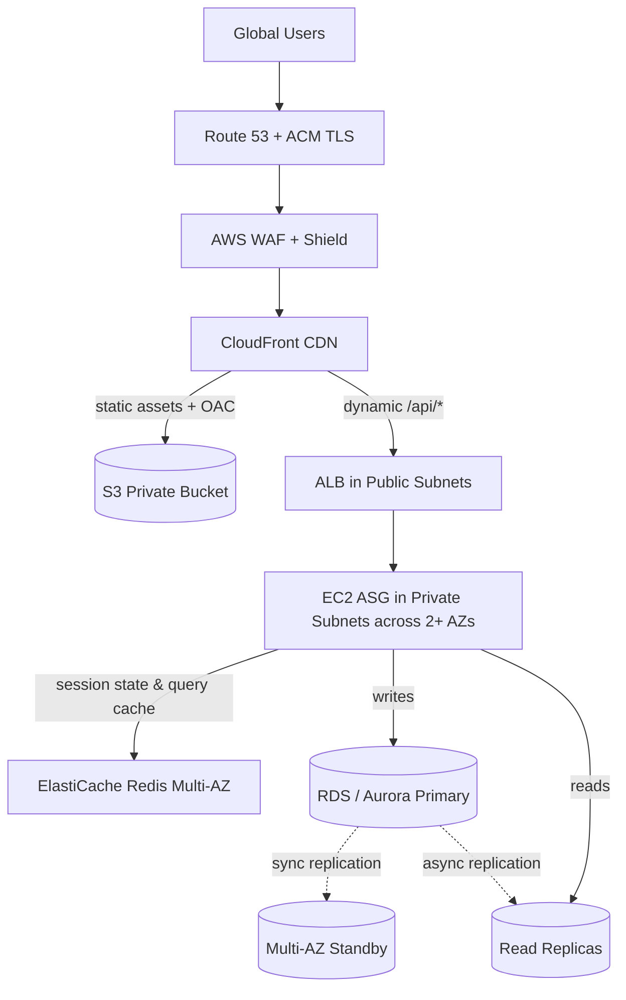
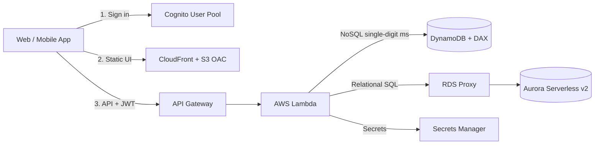
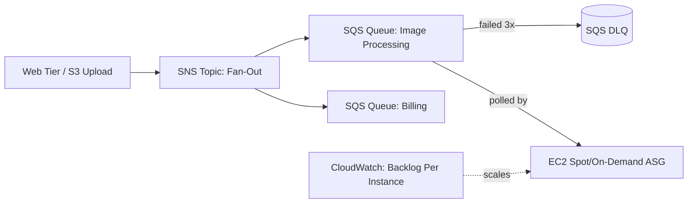
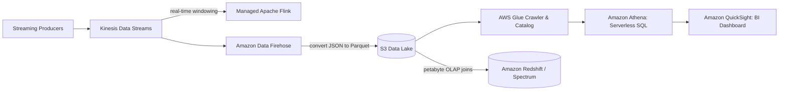
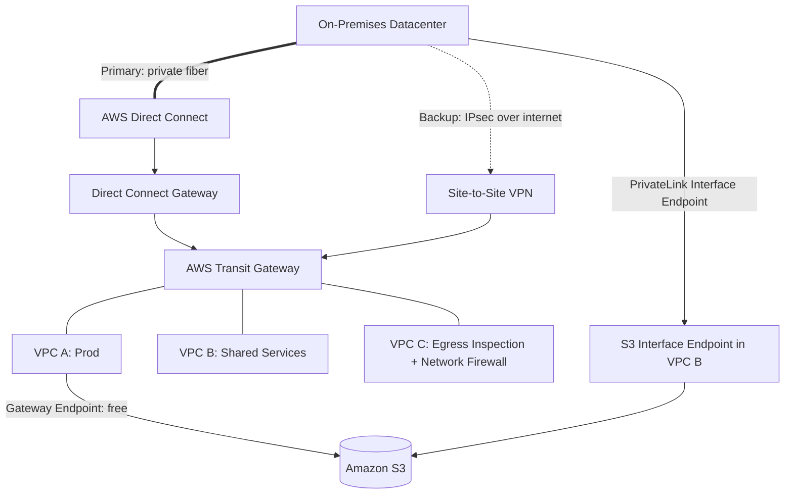

# AWS SAA-C03 Architecture Playbook: 5 Golden Reference Blueprints

Almost every scenario question on the SAA-C03 exam is a variation of **five reference architectures**. When you read a long 5-sentence question, map it to one of these blueprints first, then find the missing or broken link.

---

## 1. The Multi-AZ 3-Tier Web Architecture (HA + Scalable + Secure)

Used when: *"A company runs a traditional web application on EC2 (Elastic Compute Cloud) and RDS (Relational Database Service) that must survive an AZ (Availability Zone) outage, scale with traffic, block SQL injection, and offload static assets."*

### How exam questions mutate this blueprint:
- **"Users lose their shopping cart when an EC2 instance terminates"** → Move session state out of EC2 memory into **ElastiCache for Redis** or **DynamoDB** (avoid sticky sessions).
- **"Database CPU hits 100% due to identical product catalog queries"** → Add **ElastiCache** (or **Read Replicas** if queries are dynamic reporting).
- **"Prevent users from bypassing CloudFront to hit the ALB directly"** → Have CloudFront add a custom secret HTTP header (stored in Secrets Manager) and configure an **ALB listener rule** to drop requests missing that header (or use the AWS-managed CloudFront prefix list in the ALB Security Group).
- **"Security Group Chain"**: `ALB SG` allows `80/443` from `0.0.0.0/0` → `App EC2 SG` allows `8080` **only from `ALB SG`** → `RDS SG` allows `3306/5432` **only from `App EC2 SG`**.

---

## 2. The Serverless Microservices Blueprint (Zero Server Management)

Used when: *"Spiky/unpredictable traffic, minimal operational overhead, no idle compute cost, mobile/web authentication."*

### How exam questions mutate this blueprint:
- **"Lambda exhausts RDS connections during traffic spikes"** → Insert **Amazon RDS Proxy**.
- **"Mobile users must upload 2 GB videos directly without hitting API Gateway's 10 MB payload limit"** → Lambda generates an **S3 Pre-Signed URL**; the client uploads **directly to S3**!
- **"Need global active-active with sub-second cross-region replication"** → **Route 53 Latency Routing + API Gateway + Lambda + DynamoDB Global Tables** (or **Aurora Global Database**).

---

## 3. The Event-Driven Decoupled Worker Blueprint (Fault Tolerance & Spikes)

Used when: *"Orders or media uploads must never be lost if worker nodes crash or traffic spikes 10x for an hour."*

### How exam questions mutate this blueprint:
- **"How should the Auto Scaling Group scale properly?"** → Never scale queue workers on CPU alone! Calculate a **Backlog Per Instance** metric (`ApproximateNumberOfMessagesVisible / RunningInstanceCount`) and use a **Target Tracking** policy.
- **"A poison-pill message causes workers to crash repeatedly in a loop"** → Configure a **Dead-Letter Queue (DLQ)** with `maxReceiveCount` (e.g., 3–5) and alarm on DLQ depth.
- **"Workers process the same message twice because the job takes 8 minutes"** → Increase the queue's **Visibility Timeout** (default is 30 seconds) or call `ChangeMessageVisibility` dynamically.

---

## 4. The Modern Data Lake & Real-Time Analytics Blueprint

Used when: *"Ingest streaming clickstream/IoT data, store cheaply, run ad-hoc SQL queries, and visualize in BI dashboards without managing servers."*

### How exam questions mutate this blueprint:
- **"Athena queries are slow and expensive"** → Convert raw CSV/JSON into **columnar Apache Parquet or ORC** (via Data Firehose or AWS Glue) and **partition S3 prefixes by date** (`s3://bucket/year=2026/month=10/`).
- **"Discover PII (credit cards, SSNs) in the S3 Data Lake automatically"** → **Amazon Macie**.
- **"Centralize fine-grained column/row-level permissions across the S3 Data Lake"** → **AWS Lake Formation**.

---

## 5. The Enterprise Hybrid & Multi-VPC Network Blueprint

Used when: *"Connect 20 VPCs (Virtual Private Cloud) and an on-premises datacenter with private connectivity, resilient failover, and private access to AWS services."*

### How exam questions mutate this blueprint:
- **"On-premises servers need to access S3 privately over Direct Connect / VPN"** → **S3 Gateway Endpoints do NOT work from on-premises!** You must create an **S3 Interface Endpoint (PrivateLink)** inside the VPC.
- **"Resolve AWS Private Hosted Zone DNS names from on-premises (and vice versa)"** → Deploy **Route 53 Resolver Inbound Endpoints** (on-prem → AWS) and **Outbound Endpoints + Forwarding Rules** (AWS → on-prem).
- **"Private EC2 instances in 3 AZs download 100 TB/month from S3 and NAT Gateway costs are huge"** → Add a free **S3 Gateway VPC Endpoint** to the private route tables.
