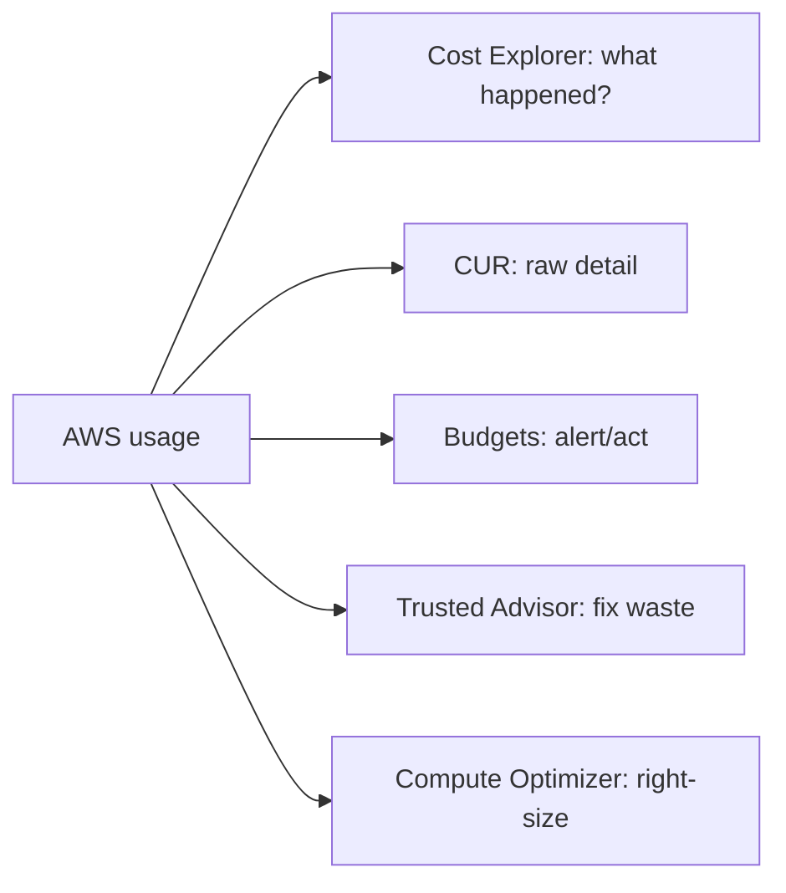

# Cost Management Tools

"Which tool should the company use to see/track/limit spending?" - the answer is one of a small set of billing tools. Learn what each one uniquely does.

## The lineup

| Tool | What it's for | Scenario keyword |
|---|---|---|
| **Cost Explorer** | Visualize & forecast costs, RI (Reserved Instance)/SP (Savings Plan) utilization & coverage | "why did costs rise", "should we buy RIs" |
| **Cost & Usage Report (CUR)** | Most granular billing data (hourly, resource-level) | "detailed analysis in Athena/QuickSight" |
| **Budgets** | Alert and act at thresholds | "notify me at 80% of budget", "stop resources" |
| **Cost Anomaly Detection** | ML-based unusual-spend alerts | "sudden unexpected spike" |
| **Pricing Calculator** | Estimate costs **before** building | "what will this architecture cost" |
| **Trusted Advisor** | Best-practice checks: cost, security, performance, fault tolerance, **service limits** | "find idle resources, unattached EBS (Elastic Block Store)" |
| **Compute Optimizer** | Right-size recommendations | "is this instance too big" |
| **AWS Budgets + Billing Alarms** | Classic proactive control | CloudWatch alarm on estimated charges |

## Details worth knowing

- **Cost Explorer**: 12 months history default, forecasting up to 12 months, save custom views; **RI/SP utilization reports** answer "are we wasting our commitment"
- **CUR** is the only source with full resource-level detail → analyze with **Athena**, visualize with **QuickSight**
- **Budgets** can trigger actions (e.g. apply an IAM (Identity and Access Management) policy via Service Catalog to stop non-prod); alert types: actual, forecasted, and planned (RI/SP)
- **Trusted Advisor** full checks require Business/Enterprise support; the "cost" category finds idle ELBs (Elastic Load Balancing), unassociated Elastic IPs, low-utilization instances
- **Compute Optimizer** analyzes CloudWatch metrics and recommends right-sized instances (needs opt-in)

> Not: sinav eslesmeleri: "harcama gecmisi ve RI karari" = Cost Explorer, "en detayli veri" = CUR, "butce asiminda uyari/aksiyon" = Budgets, "bos kaynak / limit uyari" = Trusted Advisor, "instance fazla buyuk mu" = Compute Optimizer.

## Exam check

**Q1: Management wants an alert when monthly spend is forecast to exceed $10,000, and wants non-production resources stopped automatically at 100% of budget. Which service?**

- **A)** Cost Explorer
- **B)** AWS Budgets
- **C)** Trusted Advisor
- **D)** Cost & Usage Report

{}
**Answer: B.** Forecasted-threshold alerts + budget actions = Budgets.
{}

**Q2: A finance team needs resource-level, hourly billing data to build a custom chargeback dashboard in QuickSight. What should they use?**

- **A)** Cost Explorer
- **B)** AWS Budgets
- **C)** Cost & Usage Report analyzed with Athena
- **D)** CloudWatch Metrics

{}
**Answer: C.** Only CUR has resource-level granularity; QuickSight visualizes it.
{}

## Ozet

- Cost Explorer = grafik + tahmin + RI/SP kullanim raporlari
- CUR = en detayli fatura verisi (Athena + QuickSight ile)
- Budgets = limit + uyari + otomatik aksiyon
- Cost Anomaly Detection = ML ile beklenmeyen harcama
- Trusted Advisor = bos kaynak, limit, guvenlik denetimi
- Compute Optimizer = right-sizing onerileri
- Pricing Calculator = kurulmadan once maliyet tahmini
