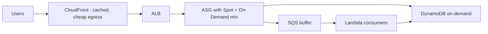

# Cost-Optimized Architecture Patterns

The last Domain 4 piece: not a tool, but a **habit set**. The exam's "MOST cost-effective" questions are usually one of these patterns wearing a scenario costume.

## The pattern checklist

1. **Right-size** - use Compute Optimizer; T-family burstables for spiky small work; don't pay for a 16-vCPU box that idles at 5%
2. **Turn things off** - dev/test schedules (Instance Scheduler), stop idle instances, delete unattached EBS volumes and idle ELBs (Trusted Advisor finds them)
3. **Pay for commitment, not flexibility** - steady state → Savings Plans/RI; see [pricing-models](../pricing-models-ri-savings-plans-spot/)
4. **Embrace Spot and serverless** - batch/CI/stateless → Spot; event-driven, spiky → Lambda/Fargate (pay per use, no idle)
5. **Right storage class + lifecycle** - [s3-cost-and-lifecycle-policies](../s3-cost-and-lifecycle-policies/)
6. **Cache to cut backend load** - CloudFront + ElastiCache = fewer DB instances, less egress (also better perf)
7. **Route data cheaply** - VPC gateway endpoints (free S3 access vs NAT charges), keep inter-service traffic in-region/AZ, CloudFront for internet egress
8. **S3 instead of compute** - static hosting on S3/CloudFront beats an always-on web server

## Cost-aware multi-tier design

Exam nuance: "most cost-effective" **still must meet requirements**. If the question says the workload is steady and latency-sensitive, Spot is wrong even though it's cheapest. Cost answers are always "cheapest **that works**".

> Not: sinavda "dusuk maliyet" sorularinin cevaplari genelde su ucunden biridir: is yukunu kaldir (serverless), is yukunu kaydir (Spot/RI), veriyi ucuzlat (storage class/cache). Sadece "en dandik makineyi sec" cevabi neredeyse hic cikmaz.

## Exam check

**Q1: A nightly batch job processes images for 2 hours and can restart from checkpoints. The MOST cost-effective compute is:**

- **A)** A reserved m5.2xlarge running 24/7
- **B)** Spot instances via AWS Batch
- **C)** An on-demand c5.4xlarge
- **D)** A dedicated host

**Answer: B.** Short, restartable, fault-tolerant job = Spot (or Lambda if it fits - but "2 hours, checkpoints" points to Spot/Batch).

**Q2: A small company needs to host a mostly static marketing site with a contact form, at the lowest cost. What should be used?**

- **A)** An EC2 web server running 24/7
- **B)** S3 static website hosting + CloudFront + Lambda/API Gateway for the form
- **C)** A three-tier RDS-backed app
- **D)** An ECS cluster

**Answer: B.** Static content doesn't need always-on compute.

## Ozet

- Right-size + kapati bos kaynaklari + taahhut ile indirim
- Batch/test/stateless = Spot; spiky/olay-odakli = Lambda/Fargate
- Cache (CloudFront/ElastiCache) = hem hiz hem maliyet
- VPC gateway endpoint = NAT ucretlerini siler
- Statik site = S3 + CloudFront, sunucu gerekmez
- "En ucuz" daima "gereksinimleri karsilayan en ucuz" demektir
