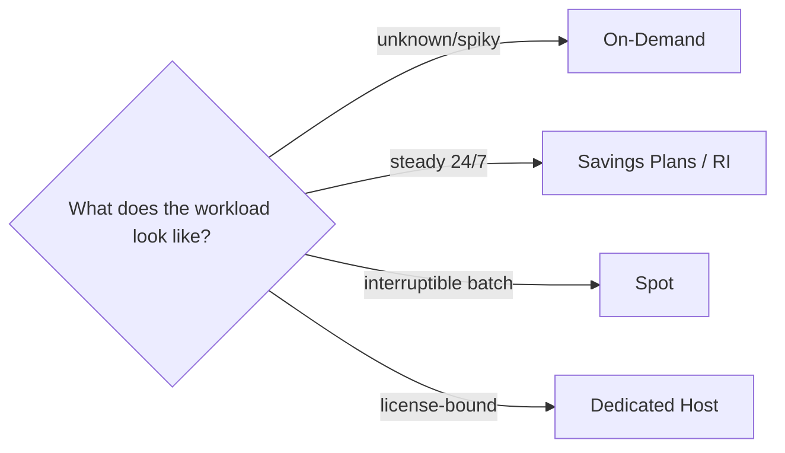

# Pricing Models: On-Demand, RIs, Savings Plans and Spot

Almost every cost question is a matching game: **workload pattern → purchase option**. Get these five into your head and half of Domain 4 is free.

## The options

| Option | Discount | Commitment | Best for |
|---|---|---|---|
| **On-Demand** | 0% | None | Spiky, unknown, short-lived workloads |
| **Savings Plans** (Compute / EC2 Instance / SageMaker) | up to **72%** | 1 or 3 years, $/hour commitment | Steady usage, want flexibility |
| **Reserved Instances** (Standard / Convertible) | up to **72%** | 1 or 3 years, specific instance family | Very steady, known capacity |
| **Spot Instances** | up to **90%** | None - can be reclaimed (2-min notice) | Fault-tolerant, interruptible work |
| **Dedicated Hosts / Instances** | 0% (premium) | None/1-3y | Licensing, compliance, single-tenant |

## Savings Plans vs Reserved Instances (a favorite comparison)

- **Savings Plans** = commit to **$X/hour of compute**; covers any instance family, region (Compute SP), Fargate and Lambda too. More flexible → usually the better answer
- **Reserved Instances** = commit to a **specific instance type/region**; can be **standard** (most discount, resellable) or **convertible** (less discount, can change family/OS); zonal RI also reserves **capacity** in an AZ
- **Scheduled RIs** = recurring time windows (rarely tested)

> Not: "surekli calisan ve tahmin edilebilir is yuk" = Savings Plans (esnek oldugu icin RI'ye tercih edilir). "Kesintiye dayanikli toplu is / ML egitim / test ortami" = Spot. "Windows/SQL lisansi bizim" = Dedicated Host.

## Spot - details the exam tests

- Spare capacity at up to 90% off; AWS can reclaim with a **2-minute interruption notice**
- Combine with **ASG / Batch / ECS / EKS / Fargate Spot** and graceful shutdown handling
- **Hibernate / stop-interruptible** options for checkpoint-friendly workloads
- Diversify instance types and AZs to reduce interruption probability (see my notes: [spot-instances](../../../aws/general-knowledge/spot-instances/))

**Never** put Spot on: databases, long transactions, steady user-facing SLAs without fallback.

## Free tier & misc

- 12-month free tier (750 hrs t2/t3.micro), always-free products (Lambda 1M requests), 12-month trial offers
- **Per-second billing** for most compute (Linux) and per-GB data transfer pricing

## Exam check

**Q1: A CI/CD build farm runs thousands of short-lived jobs that can tolerate failures and must minimize cost. What should be used?**

A) On-Demand instances
B) Spot Instances
C) Dedicated Hosts
D) Standard RIs

**Answer: B.** Fault-tolerant, interruptible, cheapest = Spot.

**Q2: A company runs 40 m5.large instances 24/7 for the next 3 years and wants the largest discount but may need to switch to c5 later. Which option?**

A) Compute Savings Plans (3-year)
B) On-Demand
C) Scheduled RIs
D) Spot Instances

**Answer: A.** Steady usage + long horizon + flexibility to change families = Compute Savings Plans (a Convertible RI would also discount but Compute SP is the flexible, family-agnostic commitment).

## Ozet

- On-Demand = esnek, pahali; tahmin edilemeyen isler
- Savings Plans = $/saat taahhut, esnek (aile/bolge degisebilir), Lambda/Fargate dahil
- RI = instance'a ozel taahhut; standard = en ucuz, convertible = degistirilebilir
- Spot = %90'a varan indirim, 2 dakika onceden geri alinabilir
- Dedicated Host = lisans/uyumluluk icin tek kiracili
- Is deseni → secim eslesmesini ogren, gerisi detay
