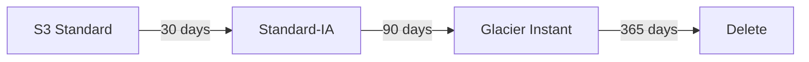

# S3 Cost Optimization and Lifecycle Policies

S3 cost questions are really about **storage class transitions** and **data transfer** - the two levers that move the bill the most.

## Lifecycle policies - the main tool

Two rule types:

- **Transition** - move objects to cheaper classes over time (e.g. Standard → IA after 30 days → Glacier Instant after 90)
- **Expiration** - delete objects/versions after N days

Example flow for a log bucket:

- Use **Intelligent-Tiering** when access patterns are unknown (small per-object monitoring fee, **no retrieval fees**)
- With **versioning** enabled, expire **noncurrent versions** too - old versions silently cost money
- **S3 Analytics** helps pick transition rules; **Storage Lens** shows account-wide cost/usage

## Cost drivers beyond storage

| Driver | How to reduce |
|---|---|
| **Data transfer OUT to internet** | CloudFront (cheaper per GB), keep clients in-region |
| **Requests** (PUT/GET) | Batch where possible; right-size storage class |
| **Data transfer between AZs** | Keep multi-tier apps within an AZ where HA allows (or use endpoints) |
| **Retrieval fees** (IA/Glacier) | Don't use IA for frequently-read data |
| **Versioning leftovers** | Lifecycle to expire noncurrent versions |
| **Incomplete multipart uploads** | Lifecycle rule to abort incomplete uploads |

> Not: "gizli tuzak" klasikleri: versiyonlanmis bucket'ta eski versiyonlar faturayi sisirir; Glacier'a atilan veri geri cikarilirken odeme yapilir (retrieval fee); internete cikis (egress) en pahali veri transferidir.

## Glacier retrieval options (cost vs speed)

- **Bulk** - 5-12 hours, cheapest
- **Standard** - 3-5 hours
- **Expedited** - 1-5 minutes, most expensive ("need one archived file now")

## Exam check

**Q1: A company stores daily backups that are never accessed after 30 days but must be retained for 7 years at minimal cost. What should be done?**

A) Keep everything in S3 Standard
B) Lifecycle rule: transition to Glacier Deep Archive after 30 days
C) Delete after 30 days
D) Enable Transfer Acceleration

**Answer: B.** Long retention + no access + cheapest = Deep Archive transition.

**Q2: An S3 bill shows high charges for data transfer to the internet for a popular image-heavy website. What is the MOST cost-effective fix?**

A) Move the images to EBS
B) Serve the images through CloudFront
C) Enable versioning
D) Compress the bucket

**Answer: B.** CloudFront's per-GB rate beats S3 internet egress, and it caches repeats.

## Ozet

- Lifecycle = gecis (transition) + silme (expiration) kurallari
- Bilinmeyen erisim = Intelligent-Tiering (geri cekme ucreti yok)
- Versioning = eski versiyonlari expire etmeyi unutma
- Glacier geri cekme: Bulk (ucuz/yavas) → Standard → Expedited (pahali/hizli)
- Internete veri cikisi = faturanin en pahali kalemi → CloudFront ile dusur
- Yarim kalan multipart upload'lari lifecycle ile temizle
- S3 Analytics = gecis kurallarina karar verme, Storage Lens = genel gorus
