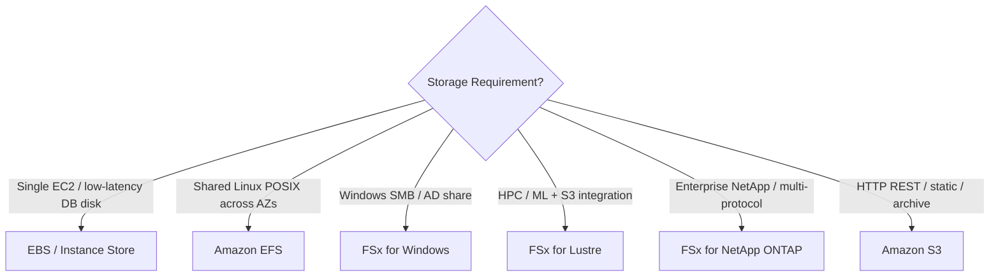

# Block and File Storage: EBS, EFS and Amazon FSx Deep Dive

S3 (Simple Storage Service) handles objects, but applications running on EC2 (Elastic Compute Cloud) or containers often need **block storage** (like a local hard drive) or **shared file storage** (NFS/SMB). Choosing the right storage type, volume tier, or FSx flavor is one of the most heavily tested topics on the SAA-C03 exam.

## Block vs File vs Object at a glance

## Amazon EBS (Elastic Block Store)

EBS volumes are **network-attached block disks** locked to a **single Availability Zone (AZ)**. To move a volume to another AZ, you **snapshot it and restore** in the target AZ.

### EBS Volume Types

| Type | Category | Max IOPS / Throughput | Exam Use Case |
|---|---|---|---|
| **gp3** / gp2 | General Purpose SSD | **16,000 IOPS** (gp3 scales IOPS & throughput **independently** of size!) | Boot volumes, dev/test, most workloads |
| **io1 / io2 / io2 Block Express** | Provisioned IOPS SSD | **64,000 – 256,000 IOPS**, 99.999% durability (io2) | Mission-critical databases needing **>16,000 IOPS** or sub-millisecond latency |
| **st1** | Throughput Optimized HDD | 500 IOPS / 500 MB/s | Big data, data warehouses, sequential log processing (**CANNOT be a boot volume**) |
| **sc1** | Cold HDD | 250 IOPS / 250 MB/s | Cheapest block storage for infrequent sequential access (**CANNOT be a boot volume**) |

### EBS Exam Traps & Features

- **EBS Multi-Attach**: Available **only on `io1` and `io2`** within a **single AZ** (up to 16 EC2 instances). You **must** use a cluster-aware file system (like GFS2); standard EXT4/XFS will corrupt data! If the question wants a simple shared file system across AZs, pick **EFS**, not Multi-Attach.
- **Instance Store vs EBS**: Instance Store is physically attached NVMe/SSD on the host → **highest possible IOPS (hundreds of thousands)**, but **ephemeral** (data is lost if the instance stops or the host fails; survives reboots). Use for temporary caches, buffers, or scratch data.
- **Snapshots**:
  - Incremental backups stored in S3.
  - **EBS Snapshot Archive**: up to **75% cheaper** for snapshots kept 90+ days; takes 24–72 hours to restore.
  - **Fast Snapshot Restore (FSR)**: eliminates the initial I/O latency penalty ("pre-warming") on restored volumes (costs extra per hour).
  - **Recycle Bin** for EBS Snapshots & AMIs (Amazon Machine Image): protects against accidental deletion with retention rules.
- **RAID on EBS**: **RAID 0** stripes across 2+ volumes to multiply IOPS/throughput (no fault tolerance); **RAID 1** mirrors for redundancy (rarely needed since EBS replicates within the AZ).

## Amazon EFS (Elastic File System)

Managed **NFSv4 (Linux/POSIX)** shared file system that scales automatically and can be mounted by **thousands of EC2 instances, Lambda functions, and ECS (Elastic Container Service)/EKS (Elastic Kubernetes Service) containers across multiple AZs**.

| Knob | Options | When to pick |
|---|---|---|
| **Storage Classes** | **Standard** (Multi-AZ) vs **One Zone** (1 AZ, ~47% cheaper) + **IA (Infrequent Access)** via Lifecycle | Production shared files → Standard + Lifecycle to IA; Dev/test or reproducible → **EFS One Zone** |
| **Performance Mode** | **General Purpose** (default, lowest latency) vs **Max I/O** (higher aggregate throughput, slightly higher latency) | Web serving / CMS → General Purpose; Big data / media processing across 100s of nodes → **Max I/O** |
| **Throughput Mode** | **Elastic** (auto-scales for unpredictable traffic), **Bursting** (scales with storage size), **Provisioned** (set fixed MB/s regardless of size) | Small dataset needing high throughput → **Provisioned**; Spiky/unknown → **Elastic** |

> [!WARNING]
> **Sınav Tuzağı (Exam Trap):** EFS **sadece Linux (POSIX/NFS)** destekler; Windows EC2 instance'ları için yerel SMB paylaşımı sorulursa cevap EFS değil, **FSx for Windows File Server**'dır!

## Amazon FSx - the 4 specialized file systems

Whenever EFS doesn't fit because of protocol (Windows/SMB), extreme HPC speed, or enterprise storage features, pick the matching FSx service:

| Service | Protocol / OS | Key Exam Keywords & Features |
|---|---|---|
| **FSx for Windows File Server** | **SMB & NTFS** (Windows) | **Active Directory** integration, ACLs, DFS (Distributed File System) Namespaces, Multi-AZ HA, SQL Server failover clusters |
| **FSx for Lustre** | POSIX (Linux) | **HPC (High Performance Computing)**, **Machine Learning**, sub-ms latency, hundreds of GB/s. Seamless **S3 integration** (presents an S3 bucket as a fast file system and writes results back). Modes: **Scratch** (temporary, bursty, **no replication**, cheaper) vs **Persistent** (replicated within the AZ) |
| **FSx for NetApp ONTAP** | **Multi-protocol** (NFS, SMB, iSCSI) | Migrate existing **NetApp / ONTAP** workloads; works with Linux, Windows & macOS simultaneously; built-in **SnapMirror**, instant clones, compression & deduplication |
| **FSx for OpenZFS** | NFS (v3/v4) | Migrate **ZFS** file servers; point-in-time snapshots, copy-on-write clones, sub-millisecond latency |

## Exam check

**Q1: A machine learning team stores 80 TB of training datasets in Amazon S3. Their GPU cluster on EC2 needs to process this data as a POSIX file system with hundreds of GB/s throughput for a 6-hour training run, at the lowest cost. If a storage server fails during the run, the job can simply be restarted. Which storage solution should be used?**

- **A)** Amazon EFS with Max I/O performance mode
- **B)** Amazon FSx for Lustre with a Scratch file system linked to the S3 bucket
- **C)** Amazon FSx for Lustre with a Persistent file system
- **D)** EBS `gp3` volumes with Multi-Attach

{}
**Answer: B.** HPC/ML + native S3 integration + hundreds of GB/s = FSx for Lustre. Because the job is short-lived and can tolerate failure ("lowest cost"), **Scratch** beats Persistent.
{}

**Q2: A legacy relational database running on EC2 requires a single block storage volume capable of sustaining 50,000 IOPS consistently. Which storage option meets this requirement?**

- **A)** EBS `gp3`
- **B)** EBS `io2` (Provisioned IOPS SSD)
- **C)** EBS `st1` (Throughput Optimized HDD)
- **D)** Amazon EFS Standard

{}
**Answer: B.** `gp3` tops out at 16,000 IOPS per volume. Sustained block IOPS above 16,000 (up to 64,000–256,000) requires `io1`/`io2`.
{}

**Q3: A company runs a Windows-based .NET application across multiple AZs that requires shared SMB storage integrated with their on-premises Microsoft Active Directory. Which service should the architect choose?**

- **A)** Amazon EFS Multi-AZ
- **B)** Amazon S3 with File Gateway
- **C)** Amazon FSx for Windows File Server (Multi-AZ)
- **D)** EBS Multi-Attach with `io2`

{}
**Answer: C.** Shared native Windows SMB + Active Directory + Multi-AZ = FSx for Windows File Server.
{}

## Ozet

- EBS = tek AZ'ye bağlı blok disk; `gp3` (16K IOPS'a kadar, bağımsız ölçek), `io2` (>16K IOPS, kritik DB, Multi-Attach), `st1`/`sc1` (HDD, boot olamaz)
- Instance Store = fiziksel sunucu üzerindeki NVMe disk; en yüksek IOPS ama geçici (instance durursa veri silinir)
- EBS Multi-Attach = sadece `io1`/`io2`, tek AZ, cluster-aware dosya sistemi şart
- EFS = çoklu AZ paylaşımlı Linux (NFS/POSIX) dosya sistemi; maliyet için EFS One Zone ve IA Lifecycle
- FSx for Windows = SMB, NTFS, Active Directory, Multi-AZ
- FSx for Lustre = HPC/ML, S3 entegrasyonu; Scratch (ucuz/geçici) vs Persistent (kalıcı)
- FSx for NetApp ONTAP = çoklu protokol (NFS+SMB+iSCSI), deduplication, SnapMirror
- FSx for OpenZFS = ZFS göçü, anlık klon ve snapshot
