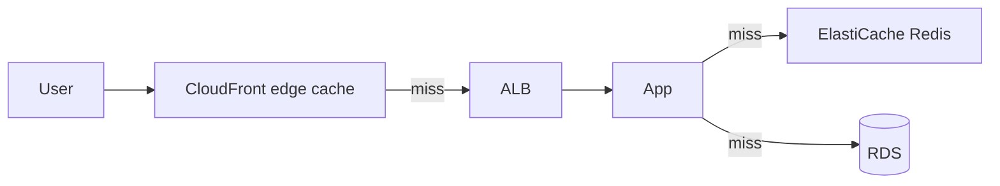

# Caching: ElastiCache, CloudFront and DAX (DynamoDB Accelerator)

The fastest query is the one you never make. Caching questions on the exam come down to: **what layer** (CDN, application, database) and **which engine** (Redis vs Memcached vs DAX).

## Cache placement - pick the layer

| Latency source | Fix |
|---|---|
| Static content far from users | **CloudFront** (edge caching) |
| Repeated DB queries / session data | **ElastiCache** in front of the DB |
| DynamoDB reads need microseconds | **DAX** |
| API responses repeat | **API Gateway caching** |

## ElastiCache: Redis vs Memcached

| | **Redis** | **Memcached** |
|---|---|---|
| Data structures | Rich (lists, sets, sorted sets, streams) | Simple key-value strings |
| Replication / failover | **Yes** (Multi-AZ with auto failover) | No |
| Persistence | Yes (snapshots, AOF) | No |
| Clustering | Yes (cluster mode, sharding) | Multi-threaded scaling |
| Pub/Sub, Lua, transactions | Yes | No |
| Typical use | Session store, leaderboards, chat, queues | Simple object caching |

Exam shortcut: "failover / durability / data structures / sorted leaderboard" → **Redis**. "Pure cache, simplest and fastest horizontal scaling" → **Memcached**.

## Cache strategies (know the trade-offs)

- **Lazy loading** (cache-aside): cache only what's requested; cheap on cache size, but first request after expiry = cache miss → DB hit
- **Write-through**: write to cache and DB together; consistent, but writes are slower and everything gets cached
- **TTL (time to live) management**: expired = stale data gone; "the product name is wrong after update" → missing invalidation / TTL question
- Session state in Redis = the standard "sticky sessions are bad, where do sessions go" answer

## DynamoDB DAX

- **Write-through cache** for DynamoDB, API-compatible (change the endpoint, done)
- Microsecond reads for eventually-consistent hot data; survives node failures (multi-AZ cluster)
- Not for writes-heavy or full table scans - it's a read cache (see [dynamodb-deep-dive](../dynamodb-deep-dive/))

## CloudFront caching knobs

- **TTL** per behavior (origin sets `Cache-Control: max-age`; you can override)
- **Invalidation** to purge objects early (see [cloudfront-invalidation](../../../aws/cdn/cloudfront-invalidation/))
- **Signed URLs / cookies** for private content ([presigned-urls](../../../aws/cdn/presigned-urls/))
- Cuts **data transfer costs**: edge serves repeats, origin serves misses

> Not: "kullaniciya hizli goster" katmani CloudFront, "veritabanina gitmesin" katmani ElastiCache, "DynamoDB sorgusu mikrosaniyeye insin" = DAX. Ucunu ayni mimaride birlikte gormek normal.

## Exam check

**Q1: A product catalog API runs the same SQL queries thousands of times per minute against RDS (Relational Database Service). What gives the biggest performance gain?**

- **A)** Switch RDS to Multi-AZ
- **B)** Add ElastiCache in front of the database
- **C)** Add read replicas
- **D)** Enable RDS Performance Insights

{}
**Answer: B.** Repeated identical queries = cache. Read replicas help too, but caching removes most DB hits entirely.
{}

**Q2: Session data must survive the failure of a node and support sorted-set leaderboards. Which engine?**

- **A)** Memcached
- **B)** Redis
- **C)** DynamoDB
- **D)** S3 (Simple Storage Service)

{}
**Answer: B.** Replication + data structures = Redis.
{}

## Ozet

- CloudFront = istemciye en yakin statik katman (maliyet de dusurur)
- ElastiCache = uygulama onu cache, DB yukunu alir
- Redis = replikasyon, kalici, veri yapilari, failover; Memcached = saf basit cache
- Lazy loading = sadece istenen cache'lenir, ilk istek miss
- Write-through = tutarli ama yavas yazma
- DAX = DynamoDB icin write-through cache, mikrosaniye okuma
- TTL / cache invalidation = bayat veri sorularinin cevabi
