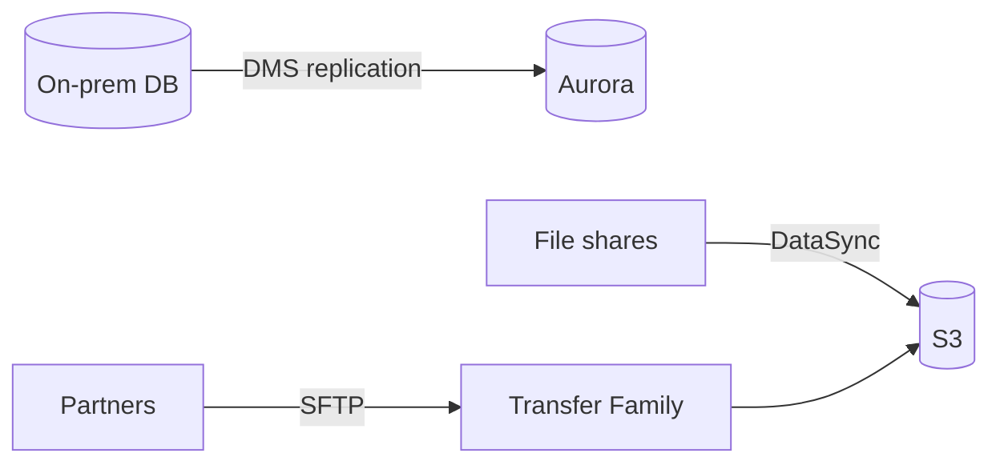

# Data Transfer and Hybrid Services

Moving data is its own question family: "we have 500 TB on-premises, get it to S3" or "users must still write to a local file server". Each answer is a specific service - and mixing them up is easy, so learn the **one job per service**.

## The transfer service lineup

| Service | Job | Scenario keyword |
|---|---|---|
| **DataSync** | Scheduled bulk transfer (NFS/SMB/HDFS/object → S3/EFS/FSx) | "migrate file shares", "agent, scheduled, fast" |
| **Transfer Family** | Managed **SFTP / FTPS / FTP** endpoints backed by S3/EFS | "partners upload via SFTP" |
| **Storage Gateway** | **Hybrid**: local file/volume/tape interface → S3/EBS-backed | "on-prem apps keep using local protocols" |
| **Snow Family** | Physically ship petabytes | "no bandwidth / 100 TB+" |
| **AWS Backup** | Centralized backup plans | "tag-based backup across services" |

## Storage Gateway modes (classic exam trio)

- **File Gateway** - NFS/SMB share backed by S3 objects ("local file share, objects in S3")
- **Volume Gateway** - iSCSI block storage; **cached** (hot data local, everything in S3) vs **stored** (full copy local, async backup to EBS snapshots)
- **Tape Gateway** - virtual tape library (VTL) for legacy backup software

## Snow Family

| Device | Scale | Notes |
|---|---|---|
| **Snowcone** | ~8-14 TB, rugged edge device | Edge computing + transfer |
| **Snowball Edge** | 80-210 TB | The standard "ship a box" answer |
| **Snowmobile** | 100 PB per truck | Exabyte-scale, literally a shipping container |

"Petabytes of data, limited bandwidth" → Snowball. "Ongoing streaming" → Kinesis / DataSync instead.

## Database migration - DMS and friends

- **DMS (Database Migration Service)** - keeps the source running while replicating to the target (minimal downtime migration). Homogeneous (Postgres→Postgres) works directly; heterogeneous (Oracle→Aurora) needs **SCT (Schema Conversion Tool)** first
- **DMS + SCT** is the answer to "migrate Oracle to Aurora with minimal downtime"
- **Application Migration Service (MGN)** - lift-and-shift whole servers (physical/VMware) to EC2
- **Migration Hub** - single dashboard tracking all migrations
- Aurora has native **MySQL/PostgreSQL compatible** engines = "migrate without rewriting queries"

> Not: karar kisa yollari: "dosya paylasimi tasi" = DataSync, "SFTP sunucusu istiyorlar" = Transfer Family, "yerel sistem S3'u gorsun" = Storage Gateway, "veri cok internet yavas" = Snow, "DB tasi kesintisiz" = DMS.

## Exam check

**Q1: Business partners must upload daily reports using SFTP, and the files must land in S3 without managing any servers. What should the architect use?**

A) AWS DataSync
B) AWS Transfer Family
C) Storage Gateway File Gateway
D) Snowball Edge

**Answer: B.** Managed SFTP front-end to S3 = Transfer Family.

**Q2: A 300 TB file archive on-premises must move to S3, but the WAN link is 50 Mbps. What is the fastest practical approach?**

A) DataSync over the WAN
B) AWS Snowball Edge
C) S3 Transfer Acceleration
D) RDS snapshots

**Answer: B.** 300 TB over 50 Mbps would take months; ship a Snowball.

**Q3: An on-premises application must keep using local iSCSI block storage while data is backed up to AWS. Which service?**

A) Volume Gateway (stored mode)
B) File Gateway
C) Transfer Family
D) EFS

**Answer: A.** iSCSI block storage = Volume Gateway; stored mode keeps the full dataset locally with async EBS snapshots.

## Ozet

- DataSync = toplu dosya tasiyici (agent'li, planli)
- Transfer Family = yonetilen SFTP/FTP onu, S3/EFS arkasi
- Storage Gateway = hibrit: File (SMB/NFS), Volume (iSCSI), Tape (VTL)
- Snow = fiziksel veri tasima (100 TB+ / bant genisligi yok)
- DMS = veritabani tasi (min kesinti), SCT = schema cevirme
- MGN = sunucu lift-and-shift, Migration Hub = tek izleme paneli
