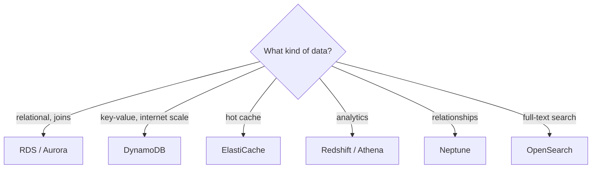

# Database Selection Matrix

The most common question format in Domain 3: "the application needs X - which database?" There are ~10 AWS database services and exactly one right answer per workload. Learn the workload → service mapping.

## The decision table

| Workload | Service | Why |
|---|---|---|
| Relational OLTP (online transaction processing), joins, transactions, known schema | **RDS (Relational Database Service)** (or **Aurora** for cloud-native scale) | Managed SQL, Multi-AZ, replicas |
| Massive-scale key-value, any traffic shape, single-digit ms | **DynamoDB** | Serverless NoSQL, unlimited scale |
| Hot data, microsecond reads, session store | **ElastiCache** (Redis/Memcached) | In-memory |
| Data warehouse, OLAP (online analytical processing), columnar analytics | **Redshift** | Petabyte analytics |
| Interactive SQL on S3 (Simple Storage Service) data lake | **Athena** | Serverless, pay per query |
| Search, autocomplete, log analytics | **OpenSearch** | Full-text search |
| Document workloads, MongoDB-compatible | **DocumentDB** | Mongo API without Mongo ops |
| Graph relationships (social, fraud, routes) | **Neptune** | Graph DB |
| Time series (IoT, metrics) | **Timestream** | Built for timestamps |
| Immutable ledger / audit | **Aurora PostgreSQL / S3 Object Lock** *(Note: AWS deprecated **QLDB** on July 31, 2025)* | Cryptographic verifiability / WORM |
| In-memory cache with SQL on RDS-adjacent | **Redis** | Microsecond latency |
| Query exabytes in S3 directly from a data warehouse | **Redshift Spectrum** | Joins Redshift tables with S3 Parquet files without loading |

## RDS vs DynamoDB - the heavyweight bout

Pick **RDS/Aurora** when:

- The data is **relational** (joins, foreign keys, complex queries)
- You need stored procedures, or the app is already SQL-based
- Schema is stable and the team knows SQL
- Strong secondary-index query flexibility

Pick **DynamoDB** when:

- **Massive scale**, unpredictable traffic ("internet scale")
- Simple access patterns: key lookup, few queries
- You want **zero server management** and per-request pricing
- Need single-digit ms latency at any scale

Hybrid is fine and common: DynamoDB for hot user data, RDS for orders/invoices, ElastiCache in front.

## OLTP vs OLAP (favorite definitions)

- **OLTP** (online transaction processing) - many small fast transactions: RDS, Aurora, DynamoDB
- **OLAP** (online analytical processing) - big scans and aggregations: **Redshift** (warehouse), Athena (serverless on S3), EMR (Elastic MapReduce) - Hadoop/Spark

"Run complex analytical queries over years of data without affecting the transactional database" → **ETL into Redshift** (Glue for the extract/transform part).

> Not: sinavda "is yukunu acikla, sen dogru veritabanini sec" tipi soru gelir. Anahtar kelimeler: "join/transaction" = RDS, "internet olcegi, anahtar-deger" = DynamoDB, "analiz/data warehouse" = Redshift, "arama" = OpenSearch, "graf" = Neptune.

## Exam check

**Q1: A startup expects unpredictable traffic from 0 to 10 million users and stores simple user profile records accessed by user ID. Which database?**

- **A)** RDS MySQL
- **B)** DynamoDB
- **C)** Redshift
- **D)** ElastiCache

{}
**Answer: B.** Key-value access + internet scale + unpredictable = DynamoDB.
{}

**Q2: A data team needs to run complex analytical joins over 3 years of sales data without slowing down the order-processing database. What should be used?**

- **A)** Add read replicas to RDS
- **B)** Move analytics to Redshift and load with Glue
- **C)** Run the queries on the RDS primary
- **D)** Enable DynamoDB DAX (DynamoDB Accelerator)

{}
**Answer: B.** OLAP workload = warehouse (Redshift), ETL via Glue.
{}

## Ozet

- RDS/Aurora = iliskisel, join, transaction, SQL
- DynamoDB = anahtar-deger, sinirsiz olcek, tek haneli ms
- ElastiCache = hafiza ici cache / session
- Redshift = data warehouse (OLAP), Athena = S3 uzerinde sunucusuz SQL
- OpenSearch = tam metin arama, Neptune = graf, Timestream = zaman serisi
- OLTP = RDS/DynamoDB, OLAP = Redshift/Athena/EMR
- Genelde hibrit: sicak veri DynamoDB, faturalar RDS, on cache Redis
