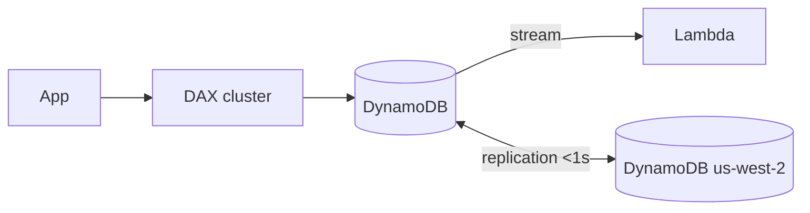

# DynamoDB Deep Dive

DynamoDB shows up in ~a third of all "which database" and "how do I scale reads" questions. The exam-level knowledge is: **partitioning, capacity modes, indexes, DAX (DynamoDB Accelerator) and Global Tables**.

## Data model basics

- **Table → items (rows) → attributes (columns)** - schemaless except the key
- **Partition key** (required) - hashed to decide storage partition; good partition keys spread load evenly
- **Composite key** = partition key + **sort key** - enables range queries (`WHERE orderId = X AND date BETWEEN...`)
- Item max size **400 KB**
- Access is via `Query` (key condition) or `Scan` (everything - avoid it)

## Capacity modes

| | **On-demand** | **Provisioned** |
|---|---|---|
| Pricing | Per request (pay per use) | Per hour on WCU (write capacity unit)/RCU (read capacity unit) + autoscaling |
| Best for | Unknown, spiky traffic | Steady, predictable traffic |
| Scaling | Instant, no planning | Auto scaling policy on utilization |

- **1 WCU** = 1 KB write per second; **1 RCU** = 4 KB strongly consistent read per second (2x for eventually consistent)
- Reads: **eventually consistent** by default (duplicates at read time possible), **strongly consistent** = 2x RCU

## Indexes

| | **LSI (local secondary index)** | **GSI (global secondary index)** |
|---|---|---|
| Key | Same partition key, new sort key | Any key (new partition + sort) |
| Consistency | Can be strongly consistent | **Always eventually consistent** |
| Limits | 5 per table | 20 per table |
| Availability | Same partition as item | "Global" = separate index |

Sparse index trick: items missing the indexed attribute are simply not in the index - filter by putting an attribute only on some items.

## Scaling and acceleration features

- **DAX** - write-through in-memory cache, microsecond reads, API-compatible (see [caching](../caching-elasticache-cloudfront/))
- **Global Tables** - multi-region, **multi-active** replication (conflict resolution last-writer-wins), <1s replication → DR (disaster recovery) + local latency
- **DynamoDB Streams** + Lambda - react to item changes (event-driven)
- **TTL (time to live)** - auto-delete expired items (sessions, temp data)
- **Transactions** - ACID across multiple items/tables (up to 100 items per transaction)
- **PartiQL** - SQL-like syntax for DynamoDB
- Adaptive capacity handles "hot partitions" automatically

> Not: sinav sik tuzaklari: GSI'lar her zaman eventually consistent'tir; Scan pahalidir - soruda "performansi arttir" varsa cevap genelde index ya da DAX'tir; "cok bolgede aktif yazma" = Global Tables.

## Exam check

**Q1: A table stores orders keyed by `customerId`, and the app frequently queries "all orders for customer X between two dates". Which key design?**

- **A)** Partition key: `orderId`
- **B)** Partition key: `customerId`, sort key: `orderDate`
- **C)** Partition key: `orderDate`
- **D)** No sort key, use Scan

{}
**Answer: B.** Composite key enables the range query without a Scan.
{}

**Q2: A global application needs users in Asia and Europe to write locally with the same table, and tolerate a regional outage. Which feature?**

- **A)** DynamoDB DAX
- **B)** DynamoDB Global Tables
- **C)** Read replicas
- **D)** ElastiCache Redis

{}
**Answer: B.** Multi-region multi-active replication = Global Tables.
{}

## Ozet

- Partition key = dagilimi belirler, sort key = aralik sorgusu
- 400 KB item limiti, Scan'den kac Query'ye kos
- On-demand = tahmin edilemeyen trafik, provisioned = istikrarli is yuk
- 1 WCU = 1KB/yazma, 1 RCU = 4KB/okuma; strong = 2x RCU
- LSI = ayni partition, strong okuma; GSI = ayri indeks, hep eventual
- DAX = mikrosaniye cache, Global Tables = cok bolge aktif
- Streams = degisiklik olaylari, TTL = otomatik silme
