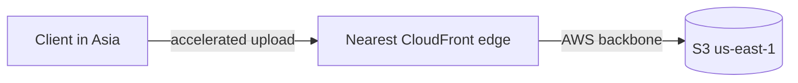

# S3 (Simple Storage Service) Storage Classes and Performance

Two things get tested: **which storage class for which data** (mostly a cost question - see [s3-cost](../../cost-optimized-architectures/s3-cost-and-lifecycle-policies/) - but with performance implications) and **how to move big data in and out fast**.

## Storage classes at a glance

| Class | Durability / AZs (Availability Zone) | Access pattern | Min storage |
|---|---|---|---|
| **S3 Standard** | 99.99% / 3+ AZs | Frequent, low latency | - |
| **Standard-IA** | 99.99% / 3+ AZs | Infrequent but instant | 30 days |
| **One Zone-IA** | 99.5% / **1 AZ** | Infrequent, re-creatable | 30 days |
| **Intelligent-Tiering** | 99.99% / 3+ AZs | Unknown/changing patterns | None (small monitoring fee/object) |
| **Glacier Instant Retrieval** | 99.99% / 3+ AZs | Archival, **ms** retrieval | 90 days |
| **Glacier Flexible Retrieval** | 99.99% / 3+ AZs | Archive, minutes-hours | 90 days |
| **Glacier Deep Archive** | 99.99% / 3+ AZs | Archive, 12-48h retrieval | 180 days |

Rules of thumb:

- "Unknown or changing access" → **Intelligent-Tiering** (no retrieval fees!)
- "Must be retrieved in milliseconds but rarely accessed" → **Glacier Instant Retrieval**
- "Regulatory 7-year retention" → **Deep Archive** + Object Lock
- "Reproducible data, cost critical, 1 AZ acceptable" → **One Zone-IA**

## Performance fundamentals

- **Strong consistency** for all operations (since Dec 2020) - read-after-write is guaranteed
- Request rates: **3,500 PUT/COPY/POST/DELETE and 5,500 GET/HEAD per prefix** - scale by spreading prefixes
- **Multipart upload**: required above 5 GB, recommended above 100 MB; up to 10,000 parts; faster and resumable
- **S3 Transfer Acceleration**: upload via CloudFront edge locations over AWS backbone - "uploads from far-away regions are slow"
- **Byte-range fetches**: download a slice of an object - parallelize big reads
- **S3 Batch Operations**: run jobs (copy, tag, restore) on billions of objects
- Max object size **5 TB**

Hands-on: [aws-s3-objects](../../../aws/s3/aws-s3-objects/), [aws-s3-bucket](../../../aws/s3/aws-s3-bucket/).

> Not: sinavda S3 performans sorusu iki kaliba iner: "buyuk dosya yukleme yavas" = multipart + Transfer Acceleration, "cok fazla istek yavas" = prefix'leri dagit / request rate. Depolama class'i sorulari ise aslinda cost sorusudur.

## Exam check

**Q1: Large video files (50 GB each) are uploaded from offices worldwide and uploads frequently fail on slow links. What improves reliability AND speed?**

- **A)** Enable versioning
- **B)** Multipart upload with S3 Transfer Acceleration
- **C)** Switch to One Zone-IA
- **D)** Increase the bucket's storage class

{}
**Answer: B.** Multipart = resumable parallel parts; Transfer Acceleration = edge-based fast path.
{}

**Q2: Medical images must be retrievable in milliseconds but are rarely accessed, and kept for 10 years. Which class?**

- **A)** Glacier Deep Archive
- **B)** Glacier Instant Retrieval
- **C)** S3 Standard
- **D)** One Zone-IA

{}
**Answer: B.** "Milliseconds but rare" = Instant Retrieval. Deep Archive takes hours.
{}

## Ozet

- Standard = sik erisim, IA = nadir ama aninda, One Zone-IA = tek AZ, yeniden uretilebilir
- Intelligent-Tiering = bilinmeyen erisim deseni, geri cekme ucreti yok
- Glacier Instant = milisaniye, Flexible = dakika/saat, Deep Archive = 12-48 saat
- Tutarlilik artik strong consistency - her islemde
- 3.500 yazar / 5.500 okuyucu per prefix = istek orani siniri
- Multipart upload buyuk dosyalarin hem hizi hem guvenilirligi
- Transfer Acceleration = dunyanin diger ucundan hizli yukleme
- 5 TB = tek obje limiti
