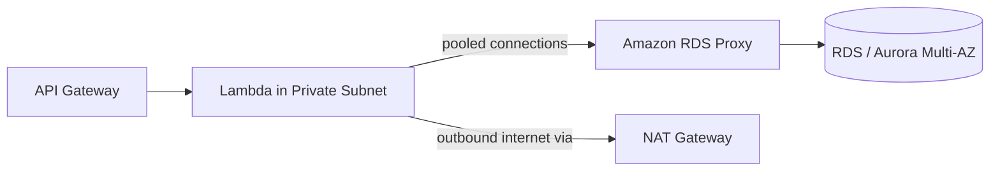

# Serverless & Containers: Lambda, RDS Proxy, API Gateway, ECS and EKS

Modern architecture questions on SAA-C03 revolve around **eliminating server management** while respecting service limits, networking rules, and database connection pools.

## AWS Lambda - limits, networking and scaling

Hands-on: [aws-lambda](../../../AWS/lambda/aws-lambda/), [lambda-api-gateway](../../../AWS/lambda/lambda-api-gateway/).

### Hard limits the exam tests
- **Max execution timeout**: **15 minutes** (900 seconds). If a job takes 25 minutes → use **AWS Fargate** or **AWS Batch**, never Lambda!
- **Memory**: **128 MB to 10 GB** — **CPU and network bandwidth scale proportionally with memory**. *"A CPU-bound Lambda function is too slow"* → **increase its memory configuration**.
- **Storage**:
  - `/tmp` ephemeral storage: **512 MB** default, configurable up to **10 GB** (shared across warm invocations in the same execution environment — great for caching static reference files).
  - Need persistent shared storage across invocations or big ML models? Mount **Amazon EFS (Elastic File System)** (requires Lambda in a VPC).
- **Deployment package**: 50 MB zipped (250 MB unzipped including **Lambda Layers**), or up to **10 GB** as a container image from ECR (Elastic Container Registry).

### Concurrency: Reserved vs Provisioned
- **Default account concurrency limit**: 1,000 concurrent executions per region (soft limit).
- **Reserved Concurrency**: caps the max concurrency for one function so it can't starve other functions (and guarantees that slice of capacity). Costs nothing extra; setting it to `0` throttles/disables the function.
- **Provisioned Concurrency**: keeps N environments pre-initialized and warm → **eliminates cold starts** for latency-sensitive APIs (costs money).

### Lambda in a VPC & the RDS Proxy pattern

1. **Lambda in a VPC has NO internet access by default** (even in a "public" subnet, Lambda ENIs (Elastic Network Interface) never get public IPs!). To call an external public API from a VPC-connected Lambda, put Lambda in a **Private Subnet with a route to a NAT Gateway**.
2. **The RDS connection storm problem**: Lambda scales out to 1,000 concurrent instances in seconds; each opens a DB connection and crashes RDS (`Too many connections`).
   - **The fix: Amazon RDS Proxy** (placed in the VPC between Lambda and RDS/Aurora).
   - Pools and shares DB connections, enforces **IAM (Identity and Access Management) authentication** with credentials stored in **Secrets Manager**, and **reduces Multi-AZ failover time by up to 66%** by preserving client connections during failover.

> [!WARNING]
> **Sınav Tuzağı (Exam Trap):** "Lambda fonksiyonları trafik patlamasında RDS veritabanında bağlantı hatası (`Too many connections` / connection exhaustion) veriyor" sorusunun cevabı Read Replica veya daha büyük RDS değil, **Amazon RDS Proxy**'dir!

## Amazon API Gateway

Managed front door for REST, HTTP, and WebSocket APIs:
- **HTTP API vs REST API**: **HTTP API** is cheaper (~70% less) and lower latency for simple OIDC/JWT + Lambda/HTTP proxy; **REST API** has all enterprise features: **API Caching** (TTL 0–3600s), **API Keys + Usage Plans**, **WAF (Web Application Firewall)** attachment, request/response transformation, and **Private APIs** (accessible only via VPC Interface Endpoint).
- **WebSocket API**: stateful two-way real-time apps (chat, live dashboards).
- **Endpoint types**: **Edge-optimized** (default, routed via CloudFront edges for global users), **Regional** (clients in the same region, or when you manage your own CloudFront in front), **Private** (VPC-only via Interface Endpoint + Resource Policy).

## Containers: ECS vs EKS vs Fargate

Hands-on: [why-ecs](../../../AWS/ecs/why-ecs/), [eks-cluster](../../../AWS/eks/eks-cluster/).

| Service | What it is | Pick when... |
|---|---|---|
| **Amazon ECS** | AWS-native container orchestration | "Run Docker containers on AWS with **least operational complexity**" |
| **Amazon EKS** | Managed **Kubernetes** control plane | "Migrate existing **Kubernetes** workloads / Helm charts / multi-cloud K8s portability" |
| **AWS Fargate** | **Serverless compute engine** for ECS & EKS | "Run containers **without managing EC2 worker nodes** or cluster patching" |
| **EC2 Launch Type** | Containers run on EC2 instances you manage | Need GPU instances, specific kernel tuning, or maximum cost savings with existing EC2 RIs/Savings Plans |
| **AWS App Runner** | Fully managed container-to-URL service | "Deploy a web app from a container image or source repo with **zero infrastructure / load balancer setup**" |

### ECS Networking & IAM Roles (exam favorites)

- **`awsvpc` network mode**: gives every ECS task its **own ENI and private IP** (required for Fargate!). Allows attaching Security Groups directly to individual tasks instead of the whole host.
- **ECS Task Execution Role vs ECS Task Role**:
  - **Task Execution Role**: used by the **ECS agent** to pull container images from **ECR**, fetch secrets from **Secrets Manager / SSM**, and write logs to **CloudWatch Logs**.
  - **Task Role**: used by **your application code inside the container** to call AWS services (e.g., `s3:PutObject`, `dynamodb:Query`).

## Exam check

**Q1: A serverless application uses AWS Lambda functions inside a VPC to write orders to an Amazon RDS MySQL database. During flash sales, Lambda scales rapidly and the database rejects new connections due to connection exhaustion. Which solution resolves this with the LEAST code change?**

- **A)** Migrate the database to Amazon Redshift
- **B)** Deploy Amazon RDS Proxy between the Lambda functions and the RDS instance
- **C)** Put an SQS (Simple Queue Service) queue after the database
- **D)** Enable Multi-AZ on the RDS instance

{}
**Answer: B.** RDS Proxy pools and multiplexes database connections from short-lived Lambda invocations and decreases failover times.
{}

**Q2: A Lambda function processes large PDF files and is timing out because the CPU-intensive parsing takes too long. There is no option to change the code. How can the architect increase the CPU power allocated to the function?**

- **A)** Change the Lambda instance type to `c6i.xlarge`
- **B)** Increase the memory allocation of the Lambda function
- **C)** Increase the `/tmp` ephemeral storage size
- **D)** Enable Provisioned Concurrency

{}
**Answer: B.** In Lambda, vCPU scales proportionally with the configured memory (up to 6 vCPUs at 10 GB RAM).
{}

**Q3: A containerized application runs on ECS Fargate. The application code inside the container fails with `AccessDenied` when trying to read items from a DynamoDB table, even though the container starts and logs to CloudWatch properly. What should be fixed?**

- **A)** Add `dynamodb:GetItem` to the ECS Task Execution Role
- **B)** Add `dynamodb:GetItem` to the ECS Task Role
- **C)** Attach an EC2 Instance Profile to Fargate
- **D)** Change the network mode from `awsvpc` to `bridge`

{}
**Answer: B.** The **Task Role** grants permissions to the application code running inside the container. The Task Execution Role is only for the ECS agent (pulling images, sending logs).
{}

## Ozet

- Lambda limitleri = max 15 dk süre, 10 GB RAM (CPU RAM ile artar!), 10 GB `/tmp`, kalıcı dosya için EFS
- Provisioned Concurrency = Cold Start'ı yok eder; Reserved Concurrency = fonksiyonun maksimum eşzamanlılığını sınırlar/garantiler
- VPC içindeki Lambda internete çıkmak için Private Subnet + NAT Gateway'e ihtiyaç duyar
- RDS Proxy = Lambda → RDS bağlantı havuzlama (`Too many connections` çözümü) + %66 daha hızlı failover
- API Gateway = REST (WAF, Cache, API Key, Private) vs HTTP (ucuz, basit) vs WebSocket (çift yönlü gerçek zamanlı)
- ECS = en kolay AWS container yönetimi, EKS = Kubernetes taşınabilirliği, Fargate = sunucusuz container çalıştırma
- ECS Task Role = uygulama kodunun AWS yetkisi; Task Execution Role = ECR'dan imaj çekme ve CloudWatch'a log basma yetkisi
