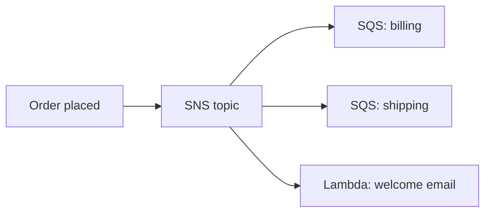

# Decoupling with SQS and SNS

"When a downstream system fails, the whole app shouldn't fail" → **decouple with a queue**. SQS/SNS questions are among the most frequent on the exam, and the answers hinge on a few precise differences.

## SQS - the pull-based queue

Producers send messages, **consumers poll and delete**. Fully managed, near unlimited scale.

### Standard vs FIFO

| | **Standard** | **FIFO** |
|---|---|---|
| Order | Best-effort (may reorder) | **Strict per message group** |
| Delivery | At-least-once (duplicates possible) | **Exactly-once processing** (deduplicated) |
| Throughput | Nearly unlimited | 300 msg/s (3,000 with batching) |
| Use when | Speed matters | Orders, payments, "exactly once" |

FIFO queue names end in `.fifo`. **Message group ID** = parallel processing lanes within ordering; **deduplication ID** = duplicate suppression window (5 min).

### Mechanics that show up in questions

- **Visibility timeout** - after a consumer picks a message it becomes invisible (default 30s). If processing will take longer, **extend it**; if the consumer crashes, the message reappears.
- **Dead-letter queue (DLQ)** - messages that fail N times are parked here instead of looping forever. "Messages keep failing" → DLQ.
- **Long polling** (`WaitTimeSeconds`) - cheaper and fewer empty responses than short polling
- **Delay queue** - postpone first delivery up to 15 min
- Message size up to **1 MB** (256 KB without the extended client)
- Retention: 1 min - 14 days

### Queue as a buffer for scaling

`ApproximateNumberOfMessages` (queue depth) as a **CloudWatch metric** → ASG scales consumers on backlog, not CPU. This is the classic "workers behind a queue" architecture.

## SNS - the push-based topic

Pub/sub: one message, **many subscribers** (fan-out). Push to SQS queues, Lambda, HTTP(S), email, SMS.

- **SNS + SQS fan-out** = the flagship pattern: one event, every team gets its own durable queue
- **Message filtering** - subscribers set filter policies so they only receive what they care about
- **SNS FIFO topics** exist for ordered fan-out
- SNS is **push**, SQS is **pull** - that one-word difference decides half the questions

> Not: karar kurali: "mesaj dayanikli dursun, islemci hizi kendine gore alsin" = SQS. "Bir olayi birden cok aliciya duyur" = SNS. "Ikisi birden" = SNS fan-out + SQS subscriber'lar.

## Kinesis vs SQS (bonus comparison)

"Real-time ordered **stream** that multiple applications replay from the same data" → **Kinesis Data Streams** (retention + shard iterators). "Just get the work done, each message processed once by one consumer" → **SQS**.

## Exam check

**Q1: Orders must be processed exactly once, in the order they were received. Which queue type?**

- **A)** SQS Standard
- **B)** SQS FIFO
- **C)** SNS Standard topic
- **D)** Kinesis Data Firehose

**Answer: B.** Exactly-once + strict ordering = SQS FIFO.

**Q2: An image upload must trigger a thumbnail generator AND a metadata indexer independently. If one consumer is down, the other must keep working. What design?**

- **A)** One EC2 worker doing both jobs
- **B)** SNS topic with an SQS queue per consumer
- **C)** An SQS standard queue polled by both consumers (competing)
- **D)** An email notification

**Answer: B.** Fan-out with per-consumer queues = independent durability. C makes consumers compete for the same messages.

**Q3: A consumer processes messages that can take up to 15 minutes, longer than the visibility timeout. What should be done?**

- **A)** Increase the message retention
- **B)** Extend the visibility timeout during processing
- **C)** Set the queue to FIFO
- **D)** Enable long polling

**Answer: B.** Otherwise the message reappears and another consumer double-processes it.

## Ozet

- SQS = kuyruk, consumer **ceker** (pull), mesajlar dayanikli bekler
- SNS = topic, **iter** (push), fan-out = bir olay cok alici
- FIFO = sirali + exactly-once (300 msg/s), Standard = hizli + at-least-once
- Visibility timeout = islem sirasinda mesaj gizli, bitmezse geri gelir
- DLQ = basarisiz mesajlarin park yeri
- SNS + SQS = klasik fan-out mimarisi
- Queue depth ile ASG olcekleme = is yiginina gore scaling
- Kinesis = gercek zamanli replay edilebilir akis
