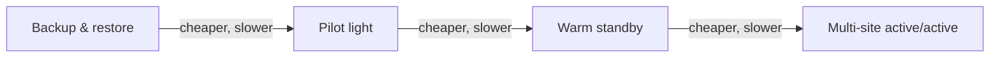

# Disaster Recovery Strategies

This is a pure memorization page with a huge payoff: the four DR strategies appear in almost every resiliency scenario. Learn them as a **cost ↔ recovery time** slider.

## Two numbers decide everything

- **RPO (Recovery Point Objective)** = how much data can I afford to **lose**? (measured in time back)
- **RTO (Recovery Time Objective)** = how fast must I be **back up**? (measured in downtime)

Backup every 24h → RPO = 24h (you lose up to a day). Restore takes 6h → RTO = 6h.

## The four strategies

| Strategy | RPO | RTO | Cost | What's running |
|---|---|---|---|---|
| **Backup & restore** | Hours | Hours | **$** | Nothing until disaster |
| **Pilot light** | Minutes | Tens of minutes | **$$** | Data services only (DB "always on") |
| **Warm standby** | Seconds-minutes | Minutes | **$$$** | A scaled-down full copy |
| **Multi-site active/active** | ~0 | ~0 | **$$$$** | Full production in 2+ regions |

- **Backup & restore** - snapshots + AMIs + cross-region S3 replication; "we can afford a day of downtime" scenarios. RDS snapshots, EBS snapshots, AWS Backup.
- **Pilot light** - the data layer (RDS Multi-AZ / Aurora) is live in the DR region, but app servers are off. On disaster: start instances from AMIs.
- **Warm standby** - a smaller but **functional** environment always running (scaled-down ASG, read replicas). Scale up on disaster.
- **Multi-site active/active** - traffic served from both regions simultaneously (Route 53 latency/weighted routing). Zero downtime, double the bill.

## Services that make each strategy happen

- **AWS Elastic Disaster Recovery (DRS, ex-CloudEndure)** → block-level replication for lift-and-shift servers, minutes-level RPO/RTO ("migrate and protect physical/vmware servers")
- **AWS Backup** → tag-based centralized backup plans with retention
- **S3 Cross-Region Replication** → RPO near zero for objects
- **Aurora Global Database** → RPO < 1 second, RTO < 1 minute
- **Route 53 failover routing** → flip DNS to the healthy region
- **RDS automated backups** → PITR (point-in-time recovery) to any second in the retention window (up to 35 days)

> Not: soruda "dakikalar icinde toparlansin ama normalde ortam kucuk kalsin" = warm standby. "Kabul edilebilir kesinti saatler, butce kisitli" = backup & restore. "Sifir veri kaybi" = aktif-aktif ya da Aurora Global + Route 53.

## Exam check

**Q1: A company can tolerate up to 4 hours of downtime and up to 1 hour of data loss, and wants the LOWEST cost. Which DR strategy?**

A) Multi-site active/active
B) Warm standby
C) Backup & restore
D) Pilot light

**Answer: C.** Hours-scale RTO/RPO + lowest cost = backup & restore.

**Q2: A system requires an RTO of 5 minutes and an RPO of 1 minute across regions. Which combination?**

A) Nightly EBS snapshots copied cross-region
B) Aurora Global Database with Route 53 failover
C) Pilot light with AMIs in a second region
D) S3 versioning

**Answer: B.** Aurora Global gives RPO < 1s / RTO < 1min; the others are too slow.

## Ozet

- RPO = kac saatlik veri kaybi olur, RTO = ne kadar surede ayaga kalkarim
- Backup & restore = ucuz, saatler; Pilot light = veri canli, uygulama kapali
- Warm standby = kucuk ama calisan kopya, dakikalar; Active/active = sifir kesinti, cok pahali
- Aurora Global = RPO<1s, RTO<1dk; DRS = sunucu blok replikasyonu
- Route 53 failover = bolge degistirmenin DNS yolu
