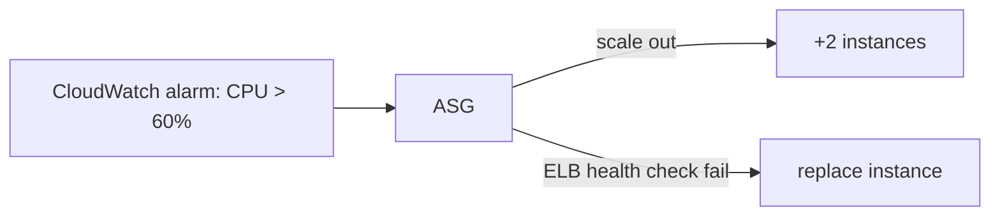

# ELB and Auto Scaling Resilience

The load balancer is the front door and the Auto Scaling Group is the immune system. Together they answer most "traffic doubles at noon" and "an instance died" questions.

## Choosing the load balancer

| | **ALB** | **NLB** | **GWLB** | CLB (legacy) |
|---|---|---|---|---|
| Layer | **7** (HTTP/HTTPS) | **4** (TCP/UDP/TLS) | 3 (IP) | 4/7 |
| Routing | Path, host, headers, query | Port/IP, ultra low latency | 3rd party appliances | Simple |
| Static IP | No (use DNS) | **Yes** (and Elastic IPs) | Yes | No |
| Use case | Web apps, containers, Lambda targets | Gaming, IoT, extreme perf, **private link entry** | Firewalls, IDS/IPS | Don't pick this |

Exam shortcuts:

- "Route based on URL path / host header" → **ALB**
- "Static IP for the load balancer / millions of requests / UDP / TLS passthrough" → **NLB**
- "Send traffic through a virtual firewall appliance" → **GWLB**
- "Serverless API behind a load balancer" → **ALB → Lambda target group**

ALB extras worth knowing: **path-based routing**, **host-based routing**, **redirects (HTTP→HTTPS)**, **authentication (Cognito/OIDC)** at the ALB, **deregistration delay** (connection draining), **deletion protection**, **cross-zone load balancing** (always on for ALB, optional for NLB).

## Auto Scaling Groups

An ASG takes a **launch template** and maintains capacity:

- `min / desired / max` size
- **Health checks**: EC2 status checks (default) or **ELB health checks** (unhealthy → replace, this is the resilient option)
- **Rebalancing** across AZs after an AZ recovers
- **Lifecycle hooks** (pause instances for custom setup before `InService`)

### Scaling policies - pick by scenario keyword

| Policy | Trigger | Scenario |
|---|---|---|
| **Target tracking** | Keep a metric at a target (e.g. CPU 50%) | "Simple, like a thermostat" - the default answer |
| **Step scaling** | CloudWatch alarm thresholds | "React in steps to large changes" |
| **Simple scaling** | One alarm → one action (has cooldown waits) | Legacy |
| **Scheduled** | Fixed times | "Scale up at 9am every weekday" |
| **Predictive** | ML forecast of the daily pattern | "Prepare before the known spike" |

Hands-on: [auto-scaling-groups](../../../aws/general-knowledge/auto-scaling-groups/), [aws-launch-template](../../../aws/ec2/aws-launch-template/).

> Not: "sunucu olurse kendini yenilesin" = ASG(1) + ELB health check. "Trafik arttikca olceklensin" = target tracking. Sinavda en sik dogru cevap target tracking'tir cunku en az yonetim yukudur.

## Exam check

**Q1: A web application must route `/api` to one set of instances and `/images` to another, and terminate HTTPS centrally. Which load balancer?**

A) NLB
B) ALB
C) GWLB
D) Route 53 weighted routing

**Answer: B.** Path-based Layer 7 routing = ALB.

**Q2: An ASG should keep average CPU utilization near 40% with the least operational effort. Which policy?**

A) Scheduled scaling
B) Simple scaling with manual alarms
C) Target tracking scaling
D) Manual instance provisioning

**Answer: C.** Target tracking is the "thermostat" policy - set a target, done.

## Ozet

- ALB = HTTP katmani, path/host routing, web uygulamalari
- NLB = TCP/UDP, statik IP, inanilmaz hiz, oyun/IoT
- GWLB = firewall appliance'larin onunden trafik gecirme
- ASG = min/desired/max, saglik kontrolu, otomatik yenileme
- Target tracking = "CPU su seviyede kalsin" - varsayilan cevap
- Scheduled = bilinen zaman patlamalari, predictive = ML tahmini
- ELB health check = instance sagliksizsa ASG onu imha eder
