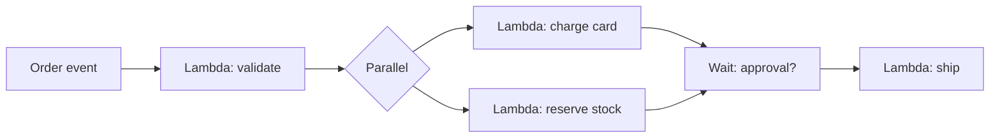

# Event-Driven Architecture: EventBridge and Step Functions

Queues move messages; **events** announce that something happened. The exam tests whether you can pick between "process this work item" (SQS), "notify everyone" (SNS), "route this event" (EventBridge) and "orchestrate this workflow" (Step Functions).

## Amazon EventBridge

The evolution of CloudWatch Events: a serverless **event bus** with rules.

- **Default bus** - AWS service events (EC2 state changes, S3 events via CloudTrail...)
- **Custom bus** - your application's events; can be shared cross-account
- **Partner sources** - SaaS events (Zendesk, Datadog, Shopify...) land directly in your bus
- **Rules** match event patterns and route to targets (Lambda, SQS, SNS, Step Functions...)
- **Content filtering**: event patterns filter on fields before delivery (unlike SNS which delivers everything)
- **Archive and replay** - store events and replay them later ("we lost 2 hours of processing")
- **Schema registry** - discover and generate code for event shapes

### EventBridge vs SNS vs SQS

| Need | Answer |
|---|---|
| Durable work queue, backpressure | **SQS** |
| One message → many push subscribers | **SNS** |
| Filter and route events by content, multiple sources, replay | **EventBridge** |
| Fan-out with durability | SNS → SQS (or EventBridge → SQS) |

"Event pattern filtering" and "replay archived events" are the two keywords that make EventBridge the answer.

## AWS Step Functions

Serverless **workflow orchestration** - each step is a state, defined in JSON (Amazon States Language).

- Integrates natively with Lambda, ECS, SQS, DynamoDB, and 200+ services
- Built-in **retries, error handling, timeouts, wait states, parallel branches**
- **Standard workflows** - long-running (up to 1 year), exactly-once execution, visual console
- **Express workflows** - high-volume (millions), up to 5 minutes, at-least-once, cheaper
- Human approval steps ("wait for a manager to click approve")

Use Step Functions when a question describes a **multi-step business process** with conditions, retries or human approval. If it's just "on event, run one function" → Lambda + EventBridge alone.

> Not: sinav kisaclari: "olay deseni ile filtreleme / tekrar oynatma" = EventBridge, "cok adimli is akisi / retry / onay adimi" = Step Functions, "dayanikli is kuyrugu" = SQS, "bildirim/duyuru" = SNS.

## API Gateway (quick mention)

Often paired in event-driven questions: managed front door for HTTP APIs with throttling, API keys, usage plans, and direct AWS service integrations. Hands-on: [lambda-api-gateway](../../../aws/lambda/lambda-api-gateway/).

## Exam check

**Q1: SaaS events from three vendors must be filtered by event type and routed to different Lambda functions, with the ability to replay yesterday's events after a bug fix. Which service?**

A) SNS with subscriptions
B) EventBridge with rules and an archive
C) SQS standard queue
D) CloudWatch Logs

**Answer: B.** Content filtering + SaaS partner sources + replay = EventBridge.

**Q2: A loan approval process runs several Lambda functions, waits for a human decision, and must retry failed steps automatically. Which service coordinates it?**

A) SQS
B) Amazon EventBridge
C) AWS Step Functions
D) AWS Batch

**Answer: C.** Multi-step orchestration with retries and wait states = Step Functions.

## Ozet

- EventBridge = olay otobusu; kaynak, filtre, hedef, arsiv + replay
- SaaS partner olaylari ve event pattern filtreleme = EventBridge
- Step Functions = sunucusuz is akisi; retry, parallel, human approval
- Standard workflow = uzun ve exactly-once, Express = kisa ve milyonlarca
- SQS = is bekleme, SNS = duyuru, EventBridge = olay yonlendirme, Step Functions = orkestrasyon
