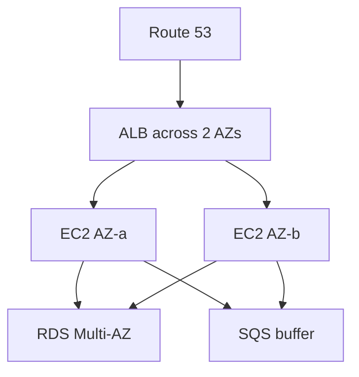

# High Availability vs Fault Tolerance

Every resilience question starts here: how much downtime is acceptable? The exam expects you to distinguish two very different promises - and to hunt for **single points of failure (SPOF)**.

## The definitions

| | **High Availability (HA)** | **Fault Tolerance (FT)** |
|---|---|---|
| Goal | Minimize downtime | **Zero** downtime |
| Behavior on failure | Recover quickly (seconds-minutes) | Continue without interruption |
| Cost | Moderate | Expensive (everything duplicated) |
| Example | Multi-AZ RDS with failover | Aircraft systems, active-active multi-region |

**Reliability** is the umbrella term: the system does what it should over time. **Scalability** (vertical vs horizontal) and **recoverability** feed into it.

> Not: soruda "kabul edilebilir kesinti kisa olsun" varsa HA, "hic kesinti olmasin, hicbir kayip olmasin" varsa FT. "En ucuz olani" sorularinda ise genelde HA + iyi bir DR plani kazanir.

## Where failures happen - the checklist

Run every architecture through this list:

1. **Instance** dies → Auto Scaling Group replaces it (cattle, not pets - see [auto-scaling-groups](../../../aws/general-knowledge/auto-scaling-groups/))
2. **AZ** dies → spread across **2+ AZs** (subnets, ELB, RDS Multi-AZ)
3. **Region** dies → multi-region: Aurora Global, S3 CRR, Route 53 failover
4. **Dependency** dies or slows down → **decouple** with SQS (see [decoupling-with-sqs-sns](../decoupling-with-sqs-sns/))
5. **Traffic spike** → ASG + ELB scaling
6. **Deployment** goes bad → multiple targets, rolling deployments, health checks

## Decoupling is resilience

A synchronous chain (web → app → queue-less worker) fails as a whole. Putting **SQS between tiers** means the producer keeps working even when the consumer is down - the messages simply wait. Stateless compute + managed state (RDS/S3/SQS) is the exam's golden architecture.

## Exam check

**Q1: An architecture must tolerate the failure of an entire Availability Zone with no manual intervention and the least operational overhead. What is the minimum design?**

- **A)** Two EC2 instances in the same AZ with an ELB
- **B)** Instances across two AZs behind an ELB (or an ASG with multi-AZ subnets)
- **C)** An EBS snapshot policy
- **D)** A larger instance type in one AZ

**Answer: B.** Multi-AZ + ELB/ASG. A survives instance failure only, C is recovery not tolerance.

**Q2: What is a "single point of failure" in a three-tier web app where all instances sit in one AZ?**

- **A)** The ELB
- **B)** The AZ itself
- **C)** The IAM role
- **D)** The AMI

**Answer: B.** Everything shares one failure domain - the AZ.

## Ozet

- HA = kesintiyi kisalt (multi-AZ), FT = kesintiyi sifirla (aktif-aktif, pahali)
- SPOF avla: instance, AZ, bolge, bagimlilik, trafik
- Multi-AZ = dayaniklilik, multi-bolge = felaket kurtarma
- Stateless + yonetilen servisler = sinavin altin mimarisi
- SQS = tuketici olse bile ureticiyi yasatir (decoupling = resilience)
