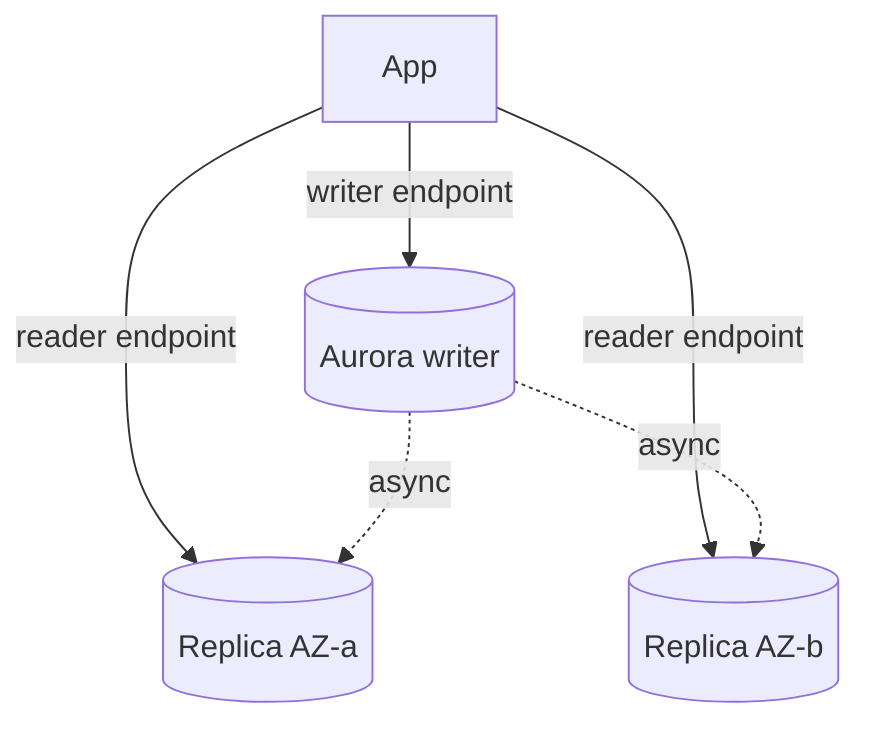

# RDS (Relational Database Service) and Aurora Resilience: Multi-AZ vs Read Replicas

The single most confused pair in the whole exam. One is for **high availability**, the other for **performance** - and mixing them up is exactly what the question writers count on.

## Multi-AZ vs Read Replicas

| | **Multi-AZ** | **Read Replica** |
|---|---|---|
| Purpose | **Failover / HA (high availability)** | **Read scaling** |
| Replication | **Synchronous** standby | **Asynchronous** |
| Reads from standby | **No** (standby is invisible) | Yes (you connect to its endpoint) |
| Failover | Automatic (~60s, DNS change) | Manual promotion |
| Regions | Same region (different AZs (Availability Zone)) | **Cross-region** possible |

Combining both is the standard "production" answer: Multi-AZ for safety, replicas for scale.

### Multi-AZ: instance vs cluster

- **Multi-AZ instance** (classic): one standby in another AZ, failover ~60s
- **Multi-AZ DB cluster** (newer, MySQL/Postgres): **two readable standbys**, failover in **~35 seconds** or less, better availability

> Not: soruda "failover olsun, kesinti olmasin" = Multi-AZ. "Okuma yuku fazla, sorgular yavasliyor" = read replica. "Bolge cokse bile ayakta kalsin" = cross-region replica ya da Aurora Global Database.

## Aurora specifics (exam gold)

- Storage is **distributed across 3 AZs, 6 copies** - self-healing, auto-scales to 128 TB
- Up to **15 read replicas** with sub-10ms replica lag; the reader endpoint load-balances them
- **Failover: < 30 seconds**, no data loss (replicas are failover targets)
- **Backtrack** (MySQL): rewind the whole DB to a point in time in seconds (no restore!)
- **Aurora Global Database**: primary region + up to 5 secondary regions → RPO (Recovery Point Objective) < 1s, RTO (Recovery Time Objective) < 1min
- **Aurora Serverless v2**: scales capacity per second, good for spiky/infrequent workloads
- Multi-master exists for write availability in one region (rarely the answer)

## RDS backups (know the RPO angle)

- **Automated backups**: daily snapshot + transaction logs → **PITR (point-in-time recovery)** to any second in the retention window (0-35 days)
- **Manual snapshots**: kept until deleted, copy across regions/accounts
- After a restore, you get a **new instance with a new DNS endpoint** - update the app

Hands-on: [rds-backups](../../../aws/rds/rds-backups/), [create-read-replicas-for-scalability](../../../aws/rds/create-read-replicas-for-scalability/), [eks-use-rds](../../../aws/eks/eks-use-rds/).

## Exam check

**Q1: A reporting application floods the primary database with heavy read queries, causing latency for writes. What is the MOST appropriate fix without changing the application architecture?**

- **A)** Switch to Multi-AZ
- **B)** Create read replicas and point reporting at them
- **C)** Enable deletion protection
- **D)** Increase the backup retention

{}
**Answer: B.** Read load → read replicas. Multi-AZ adds zero read capacity (the standby can't be read).
{}

**Q2: An Aurora deployment must survive a regional outage with an RPO of under 1 second. What should be used?**

- **A)** Automated backups with PITR
- **B)** Aurora Global Database with a secondary region
- **C)** Read replicas in the same region
- **D)** Snapshots copied weekly

{}
**Answer: B.** Global Database = RPO < 1s across regions. Snapshots are hours-scale RPO.
{}

## Ozet

- Multi-AZ = saglamlik (sync, otomatik failover), read replica = performans (async, okuma)
- Multi-AZ standby'den okuma YAPILMAZ
- Aurora = 6 kopya / 3 AZ, 15 replica, <30s failover, otomatik olceklenen depolama
- Aurora Global Database = bolgeler arasi RPO<1s, RTO<1dk
- Backtrack = anlik geri sarma (restore yok)
- PITR = saniye seviyesine kadar geri donus (35 gun)
- Restore = yeni endpoint, uygulama guncellenmeli
