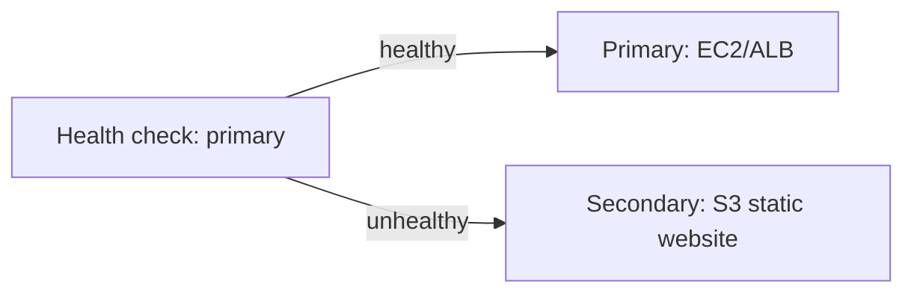

# Route 53 Routing Policies and Failover

DNS is the cheapest high-availability tool AWS gives you. The exam wants you to match a business requirement to one of seven routing policies - the words "latency", "geolocation", "failover" and "weighted" each map to exactly one answer.

## The routing policies

| Policy | What it does | Scenario keyword |
|---|---|---|
| **Simple** | One record, random answer | "single resource", no smartness needed |
| **Weighted** | Split traffic by % | "canary 10% to the new version", "A/B test" |
| **Latency** | Send users to the **lowest latency** region | "best performance for the user" |
| **Failover** | Active-passive; health check flips DNS | "disaster recovery", "passive standby" |
| **Geolocation** | Route by **user's location** | "content licensing", "different content per country" |
| **Geoproximity** | Route by resource location + bias | "shift more traffic to region X" |
| **IP-based** | Route by user's IP CIDR | "these offices go to that endpoint" |
| **Multivalue answer** | Up to 8 healthy records, client picks | "poor man's load balancing" |

## Health checks and failover

- Route 53 health checks monitor endpoints (HTTP/TCP, string match), or **CloudWatch alarms** as the source
- **Failover routing** + health check = automatic active-passive DR (disaster recovery): primary unhealthy → DNS points at secondary
- Note the DNS TTL (time to live) effect: failover is only as fast as the record's TTL (see [dns-ttl-and-caching](../../../aws/dns/dns-ttl-and-caching/))

Classic pattern - **static site failover to S3 (Simple Storage Service)**:

## Alias vs CNAME - a favorite trick

| | **Alias record** | **CNAME** |
|---|---|---|
| Apex (zone root) | **Works** | Not allowed |
| Points to | AWS resources (ALB (Application Load Balancer), CloudFront, S3 website, API GW...) | Any DNS name |
| Charges | **Free** for AWS targets | Normal DNS queries |

"Point the root domain (`example.com`, no www) at an ALB" → **Alias record**, always.

Hosted zones (public vs private) and record types are covered in my hands-on notes: [route-53-hosted-zones](../../../AWS/dns/route-53-hosted-zones/), [cloudfront-with-dns](../../../AWS/cdn/cloudfront-with-dns/).

## Route 53 / CloudFront vs AWS Global Accelerator

This comparison comes up whenever global latency or regional failover is mentioned:

| | **CloudFront** | **AWS Global Accelerator** |
|---|---|---|
| What it does | **Caches content** (HTTP/HTTPS) at 600+ edge locations | Proxies **TCP/UDP** packets onto the AWS backbone via **2 static Anycast IPs** (no caching!) |
| Protocols | HTTP / HTTPS / WebSocket | **Any TCP or UDP** (gaming, IoT, VoIP, custom ports, HTTP) |
| Static IPs for whitelisting | No (dynamic edge IPs) | **Yes — 2 static Anycast IPv4 addresses** |
| Failover speed | Depends on origin health / DNS | **< 30 seconds** (no client DNS TTL caching issues because the Anycast IP never changes!) |
| Targets | S3, ALB, API Gateway, custom HTTP | **ALB, NLB, EC2 instances, Elastic IPs** across multiple regions |

> [!NOTE]
> **Not:** Kısa hatırlatma — "latency" en hızlı bölgeye, "geolocation" kullanıcı neredeyse oraya, "weighted" yüzdelik dağılıma, "failover" sağlık kontrolüne bakar. Soruda **"2 statik IP (whitelisting), UDP/TCP oyun/finans trafiği veya DNS TTL beklemeden anında bölgesel failover"** geçiyorsa cevap **AWS Global Accelerator**'dır.

## Exam check

**Q1: A company wants 10% of traffic to go to a new application version and 90% to the current one, gradually increasing. Which routing policy?**

- **A)** Latency
- **B)** Weighted
- **C)** Geolocation
- **D)** Simple

{}
**Answer: B.** Percentage-based split = weighted.
{}

**Q2: Users in Europe must receive European-specific content, and users in the US must receive US content. Which policy?**

- **A)** Latency routing
- **B)** Geolocation routing
- **C)** Failover routing
- **D)** Multivalue answer

{}
**Answer: B.** Content varies **by where the user is** = geolocation. Latency would pick the fastest, not the "correct" content.
{}

**Q3: A primary web app in `us-east-1` must automatically fail over to an S3 static website in `eu-west-1` when its health check fails. Which routing policy?**

- **A)** Weighted
- **B)** Failover
- **C)** Geoproximity
- **D)** IP-based

{}
**Answer: B.** Active-passive + health check = failover routing.
{}

## Ozet

- Simple = tek kaynak, Weighted = yuzde dagilim, Latency = en hizli bolge
- Failover = saglik kontrolu + aktif-pasif DR
- Geolocation = icerik ulkeye gore degisir, Geoproximity = bolgeye yakinlik + bias
- IP-based = CIDR eslesme, Multivalue = 8'e kadar saglikli kayit
- Alias = apex'te calisir, AWS hedeflerine ucretsiz; CNAME apex'te yasak
- DNS TTL = failover hizini sinirlar
