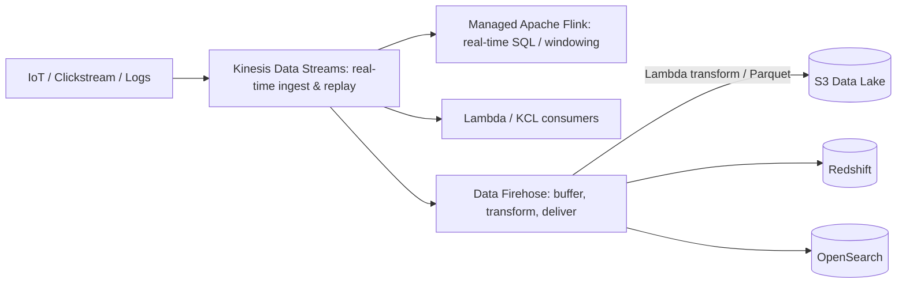

# Real-Time Streaming: Kinesis Data Streams, Data Firehose and Apache Flink

When a scenario mentions **clickstreams, IoT telemetry, financial ticks, or millions of log events per second**, you are in the streaming world. The exam tests whether you can pick between **Kinesis Data Streams (KDS)**, **Amazon Data Firehose**, **Managed Service for Apache Flink**, and **SQS (Simple Queue Service)**.

## The streaming architecture pipeline

## Kinesis Data Streams (KDS) vs Amazon Data Firehose

This is one of the highest-frequency comparisons across Domains 2 and 3:

| Feature | **Kinesis Data Streams (KDS)** | **Amazon Data Firehose** |
|---|---|---|
| Latency | **Real-time** (~70–200 ms) | **Near real-time** (buffers min **60 seconds** or **1 MB**) |
| Scaling & Management | Provisioned **Shards** (or On-Demand mode) | **Fully serverless**, scales automatically |
| Data Retention / Replay | **1 to 365 days** — consumers can **replay** stream | **No storage, no replay** (delivers and forgets) |
| Consumers / Destinations | Custom apps (KCL), **Lambda**, **Flink**, Firehose | Built-in delivery **only** to: **S3 (Simple Storage Service), Redshift, OpenSearch, Splunk / 3rd-party HTTP** |
| Data Format Conversion | You code it | Built-in **JSON → Parquet / ORC** conversion + inline Lambda transformation |

> [!WARNING]
> **Sınav Tuzağı (Exam Trap):**
> 1. **Data Firehose doğrudan DynamoDB'ye veya RDS (Relational Database Service)'e YAZAMAZ!** Hedef DynamoDB ise ya **KDS + Lambda** kullanılır ya da Firehose'tan S3'e yazılıp oradan işlenir.
> 2. Soruda **"real-time (milisaniye)"** veya **"veriyi saklayıp tekrar oynatma (replay)"** geçiyorsa cevap **Kinesis Data Streams**'tir. **"Near real-time"**, **"sıfır yönetim yüküyle S3/Redshift/OpenSearch'e akıtma"** veya **"JSON veriyi yolda Parquet'e çevirme"** geçiyorsa cevap **Data Firehose**'tur.

## Shard math & capacity modes in KDS

- **Provisioned mode**: you specify the number of **shards**
  - **1 Shard Ingest** = **1 MB/s** or **1,000 records/s** (`ProvisionedThroughputExceededException` if exceeded → split shards or fix hot partition key!)
  - **1 Shard Output** = **2 MB/s** shared across all consumers (Standard), or **2 MB/s per consumer** with **Enhanced Fan-Out** (dedicated pipe, ~70ms latency)
- **On-Demand mode**: no shard planning; scales automatically up to 200 MB/s and charges per GB + per million records.
- Ordering is guaranteed **per Partition Key** (all records with the same key go to the same shard, just like SQS FIFO message group IDs).

## Managed Service for Apache Flink (formerly Kinesis Data Analytics)

- Runs **real-time stateful processing** (sliding/tumbling windows, aggregations, anomaly detection) on streaming data from **KDS** or **MSK (Managed Streaming for Apache Kafka)**
- Supports SQL, Java, Scala, and Python
- Exam trigger: *"calculate a 5-minute rolling average on streaming IoT sensor data in real time before storing the results"*.

## Kinesis Data Streams vs SQS vs SNS

| Requirement | Pick |
|---|---|
| Decouple microservices; each work item processed **once** by one worker from a competing pool | **SQS** |
| Ordered big-data stream; **multiple independent applications** read & **replay** the same stream simultaneously | **Kinesis Data Streams** |
| Push a notification to multiple subscribers (no stream replay) | **SNS (Simple Notification Service)** |
| Managed Apache Kafka compatibility (lift-and-shift existing Kafka workloads) | **Amazon MSK** |

## Exam check

**Q1: A company collects clickstream data from millions of users and wants to load it into an S3 data lake in Apache Parquet format with the LEAST operational overhead. A 1-to-2 minute delay is acceptable. Which solution should be used?**

- **A)** Kinesis Data Streams with EC2 (Elastic Compute Cloud) consumers converting to Parquet
- **B)** Amazon Data Firehose with built-in format conversion to Parquet delivering directly to S3
- **C)** SQS FIFO queue polled by AWS Batch
- **D)** AWS DMS (Database Migration Service) replicating to S3

{}
**Answer: B.** "Near real-time (1-2 min delay acceptable) + S3 destination + JSON to Parquet conversion + least operational overhead" = Amazon Data Firehose.
{}

**Q2: An IoT platform ingests sensor telemetry into Kinesis Data Streams. Three separate applications must consume the exact same stream simultaneously with sub-100ms latency, and the producers occasionally receive `ProvisionedThroughputExceededException` for specific device types. Which TWO changes will resolve these issues? (Choose TWO)**

- **A)** Enable Enhanced Fan-Out on the Kinesis Data Stream for the three consumers
- **B)** Use a higher-cardinality partition key (such as `device_id` instead of `device_type`) or shard splitting to eliminate hot shards
- **C)** Replace Kinesis Data Streams with a single SQS Standard queue
- **D)** Increase the visibility timeout on the stream
- **E)** Switch the S3 bucket to Transfer Acceleration

{}
**Answer: A and B.** Enhanced Fan-Out gives each consumer its own dedicated 2 MB/s per shard with ~70ms latency (A). `ProvisionedThroughputExceededException` on specific device types indicates a hot shard caused by a low-cardinality partition key (B).
{}

**Q3: A financial application must compute a 1-minute moving average of stock prices in real time as events arrive in a stream, and trigger an alert immediately when an anomaly occurs. Which service should process the stream?**

- **A)** Amazon Athena
- **B)** AWS Glue ETL job
- **C)** Amazon Managed Service for Apache Flink (Kinesis Data Analytics)
- **D)** Amazon Redshift

{}
**Answer: C.** Real-time windowed aggregations and anomaly detection on streaming data = Managed Service for Apache Flink.
{}

## Ozet

- Kinesis Data Streams (KDS) = gerçek zamanlı (~70-200 ms), shard bazlı sıralama, 365 güne kadar saklama + replay
- 1 Shard = 1 MB/s (veya 1.000 kayıt/s) yazma, 2 MB/s okuma; Enhanced Fan-Out = tüketici başına 2 MB/s özel hat
- Hot shard (`ProvisionedThroughputExceededException`) = partition key'i daha tekil seç veya shard böl
- Data Firehose = near real-time (min 60 sn / 1 MB buffer), sunucusuz, replay yok, doğrudan S3/Redshift/OpenSearch/Splunk'a yazar (DynamoDB'ye yazamaz!)
- Firehose yolda Lambda ile dönüşüm ve JSON → Parquet/ORC çevirimi yapabilir
- Managed Apache Flink (eski Kinesis Data Analytics) = akış üzerinde gerçek zamanlı pencereleme (windowing) ve analiz
- Amazon MSK = yönetilen Apache Kafka
