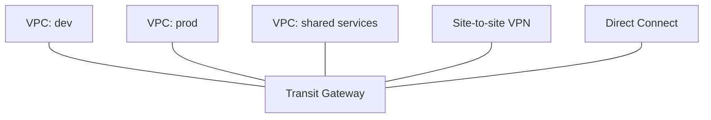

# VPC Connectivity: Peering, Transit Gateway, VPN and Direct Connect

"Connect these networks" questions come in three flavors: VPC-to-VPC, VPC-to-on-prem, and hybrid at scale. The exam wants the **right topology for the scale** - not just "what works".

## VPC Peering

Direct network connection between two VPCs using private IPs.

- **No transitive routing**: A↔B and B↔C does **not** give A↔C (mesh explodes with VPC count)
- CIDR blocks must **not overlap**
- Works **cross-region and cross-account**
- No bandwidth bottleneck (uses AWS backbone), no single point of failure
- **When**: 2-3 VPCs that all need to talk to each other

## Transit Gateway

The hub-and-spoke answer for scale:

- One regional hub, **transitive routing** by default - VPCs connect to the gateway, not to each other
- Route tables per attachment (isolation between environments)
- Connects VPCs **and** on-prem (VPN / Direct Connect) through the same hub
- Cross-region peering between transit gateways
- **When**: "many VPCs", "hub and spoke", "centralized egress", "isolate environments with route tables"

## VPN vs Direct Connect

| | **Site-to-site VPN** | **Direct Connect (DX)** |
|---|---|---|
| Transport | Internet (encrypted) | **Dedicated private fiber** |
| Speed | Up to ~1.25 Gbps per tunnel | 1-100 Gbps (or hosted 50-500 Mbps) |
| Setup | Minutes | Weeks (physical provisioning) |
| Latency/jitter | Variable | Consistent, private |
| Cost | Low | High (port hours + data out) |
| Resilience | Two tunnels per connection | **Backup with VPN** is the exam pattern |

- **BGP** propagates routes in both cases
- **Direct Connect Gateway** = one DX connection to access many VPCs in different regions
- "Must not traverse the public internet + consistent latency" → DX. "Quick, cheap, temporary or backup link" → VPN
- **AWS Client VPN** = managed OpenVPN for individual employees (not site-to-site)

## VPC Endpoints and PrivateLink (recap)

For *AWS service* access without any of the above: [network-security-sg-nacl-vpc-endpoints](../../secure-architectures/network-security-sg-nacl-vpc-endpoints/). Gateway endpoints (S3/DynamoDB) are free; interface endpoints use PrivateLink and can expose **your service** to other accounts privately.

## Choosing quickly - the exam cheat sheet

| Requirement | Answer |
|---|---|
| 2 VPCs, direct, cheap | VPC Peering |
| Many VPCs + on-prem, transitive | Transit Gateway |
| Encrypted, instant, over internet | VPN |
| Dedicated, consistent, hybrid "like a datacenter extension" | Direct Connect |
| DX for production + VPN as backup | Both (standard hybrid pattern) |
| Private access to S3 from a subnet | Gateway endpoint |

> Not: peering'de transitive routing YOK - "A-B ve B-C varsa A-C de olsun" diyorsan cevap Transit Gateway. "Haftalar surmesin" = VPN, "internet uzerinden gecmesin" = Direct Connect.

## Exam check

**Q1: A company has 30 VPCs across several accounts and wants any VPC to reach any other with centralized control and transitive routing. What should be used?**

A) Full mesh of VPC peering connections
B) Transit Gateway
C) One large VPC
D) Site-to-site VPN

**Answer: B.** Peering at 30 VPCs is a 435-connection mesh; TGW is the designed answer.

**Q2: An on-premises datacenter must connect to AWS with consistent low latency and no traffic over the public internet. Which service?**

A) Site-to-site VPN
B) AWS Direct Connect
C) VPC peering
D) Internet Gateway

**Answer: B.** Dedicated private line = Direct Connect.

## Ozet

- Peering = 2-3 VPC, dogrudan, transitive YOK, CIDR cakismamali
- Transit Gateway = hub-spoke, transitive, merkezi yonetim, on-prem dahil
- VPN = internet uzerinden sifreli, hizli kurulum, ucuz
- Direct Connect = ozel hat, istikrarli, kurulum haftalar, pahali
- DX + VPN yedek = hibrit standart
- Direct Connect Gateway = tek DX ile cok bolge/VPC
- Client VPN = tekil kullanici VPN'i (site-to-site degil)
