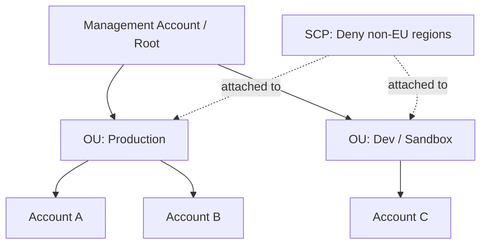

# Governance, Auditing & Operations: Organizations, Config, CloudTrail and Systems Manager

Many security and operations questions ask "how do we prevent all accounts from doing X", "who deleted the database yesterday", or "how do we manage 200 EC2 (Elastic Compute Cloud) instances without opening SSH (Secure Shell)". Each of those maps to a specific management service.

## Multi-account governance: AWS Organizations & Control Tower

- **AWS Organizations** groups multiple AWS accounts into **Organizational Units (OUs)** with **consolidated billing** (one bill + shared volume discounts, RIs (Reserved Instance) and Savings Plans across accounts).
- **SCP (Service Control Policy)** defines the **maximum allowed permissions** for member accounts (including the account's root user!).
  - SCPs **never grant permissions** — you still need IAM (Identity and Access Management) policies inside the account.
  - SCPs **do not apply to the management (master) account** itself.
  - Default strategy: **FullAWSAccess** attached everywhere + explicit `Deny` SCPs (e.g., deny leaving Organizations, deny disabling CloudTrail, restrict regions with `aws:RequestedRegion`).
- **AWS Control Tower** sets up a multi-account **Landing Zone** automatically using Organizations, IAM Identity Center, Config and CloudTrail, enforcing **preventive guardrails** (SCPs) and **detective guardrails** (Config rules).
- **AWS RAM (Resource Access Manager)** shares specific resources across accounts without duplicating them: **Transit Gateway, Subnets, Route 53 Resolver rules, License Manager**.

> [!NOTE]
> **Not:** Sınavda "tüm alt hesaplarda root dahil kimse X bölgesinde kaynak açamasın veya CloudTrail'i kapatamasın" deniyorsa cevap her zaman **AWS Organizations + SCP**'dir. SCP izin vermez, sadece üst sınır çizer.

## The observability & audit trio: CloudWatch vs CloudTrail vs Config

This three-way comparison shows up constantly on the exam:

| Service | Question it answers | Key exam features |
|---|---|---|
| **CloudWatch** | "How is it **performing** / what's in the **logs**?" | Metrics, alarms, Logs Insights, custom metrics (`mem_used_percent` via Unified Agent), Container Insights |
| **CloudTrail** | "**Who** made which **API call**, when, and from what IP?" | 90-day event history by default; **Trail → S3 (Simple Storage Service)** for long-term retention; **Log File Integrity Validation** (SHA-256 hash digest to prove logs weren't tampered with); **CloudTrail Insights** (detects unusual API spikes) |
| **AWS Config** | "What did the **resource configuration** look like, and is it **compliant**?" | Configuration history timeline, compliance rules (e.g. `s3-bucket-public-read-prohibited`), **Auto-Remediation** via **SSM (Systems Manager) Automation** documents |

Hands-on: [cloudtrail](../../../AWS/monitoring/cloudtrail/), [cloud-watch-alarms](../../../AWS/monitoring/cloud-watch-alarms/).

> [!WARNING]
> **Sınav Tuzağı (Exam Trap):** Standart EC2 CloudWatch metriklerinde **RAM (Bellek) ve Disk doluluk oranı (Disk Space) YOKTUR!** Sadece CPU, Network ve Status Check vardır. Soruda "bellek veya disk dolunca alarm çalsın" denirse **CloudWatch Unified Agent** kurulup **Custom Metric** gönderilmesi gerekir.

## AWS Systems Manager (SSM) - operations without SSH

Whenever a question says **"no bastion hosts, no inbound ports (22/3389), no SSH keys"** or **"patch 500 instances across hybrid environments"**, the answer is **Systems Manager**:

| Capability | What it does | Exam trigger |
|---|---|---|
| **Session Manager** | Browser/CLI shell access to EC2 via SSM Agent + IAM role | "Access private EC2 without opening port 22 or bastion host; log commands to S3/CloudWatch" |
| **Patch Manager** | Automated OS & software patching with maintenance windows | "Automate security patching on a schedule" |
| **Run Command** | Execute scripts across fleets (by tag or resource group) | "Run a command on 100 instances at once without SSH" |
| **Automation** | Runbooks to remediate issues (pairs with AWS Config) | "Automatically revoke public security group rules" |
| **Parameter Store** | Centralized config & secrets (see [secrets-vs-ps](../secrets-manager-vs-parameter-store/)) | "Free hierarchical configuration storage" |

Requirements for Session Manager to work on a private EC2 instance:
1. **SSM Agent** running on the instance (pre-installed on Amazon Linux 2 / 2023, Ubuntu, Windows)
2. **IAM Instance Profile** with `AmazonSSMManagedInstanceCore` policy
3. Outbound HTTPS (443) connectivity to SSM endpoints — via **NAT Gateway** or **VPC Interface Endpoints** (`ssm`, `ssmmessages`, `ec2messages`) if completely isolated from the internet.

## Exam check

**Q1: A security team wants to ensure that whenever anyone opens port 22 to `0.0.0.0/0` in any Security Group, the rule is detected and automatically removed within minutes. Which combination meets this requirement with the LEAST operational effort?**

- **A)** CloudTrail event history + manual daily review
- **B)** AWS Config managed rule (`restricted-ssh`) with automatic remediation using an SSM Automation document
- **C)** Amazon Inspector network reachability scan + SNS (Simple Notification Service) email
- **D)** VPC (Virtual Private Cloud) Flow Logs analyzed weekly with Athena

{}
**Answer: B.** Resource configuration compliance + automatic fix = AWS Config rule + SSM Automation remediation.
{}

**Q2: Engineers need shell access to private EC2 instances that have no public IP addresses and no NAT Gateway. Security policy forbids opening inbound port 22 or deploying bastion hosts, and all session commands must be audited. Which TWO actions are required? (Choose TWO)**

- **A)** Attach an IAM role with `AmazonSSMManagedInstanceCore` and connect using SSM Session Manager
- **B)** Create VPC Interface Endpoints for Systems Manager (`ssm`, `ssmmessages`, `ec2messages`)
- **C)** Create a VPC Gateway Endpoint for S3
- **D)** Open inbound TCP port 22 from the corporate IP range in the NACL (Network Access Control List)
- **E)** Attach an Internet Gateway and assign Elastic IPs

{}
**Answer: A and B.** Session Manager requires no inbound ports or SSH keys (A), and since there is no NAT Gateway or internet access, PrivateLink Interface Endpoints (B) allow the SSM Agent to reach the Systems Manager service privately.
{}

**Q3: An auditor requires cryptographic proof that CloudTrail log files stored in S3 have not been modified or deleted after delivery. Which feature should be enabled?**

- **A)** CloudTrail Insights
- **B)** CloudTrail log file integrity validation
- **C)** S3 Transfer Acceleration
- **D)** AWS Config configuration snapshots

{}
**Answer: B.** Log file integrity validation creates SHA-256 digest files signed by CloudTrail so you can verify no log was altered or deleted after delivery.
{}

## Ozet

- Organizations = çoklu hesap, konsolide fatura (RI/SP paylaşımı), OU hiyerarşisi
- SCP = hesaplara maksimum yetki sınırı çizer (root dahil), izin vermez, yönetim hesabını etkilemez
- Control Tower = hazır çoklu hesap Landing Zone + guardrail otomasyonu
- RAM = Transit Gateway, Subnet gibi kaynakları hesaplar arası paylaşma
- CloudWatch = performans/metrik/log (RAM ve Disk metrikleri için CloudWatch Agent şart!)
- CloudTrail = "kim hangi API'yi çağırdı" + Log File Integrity Validation ile bütünlük kanıtı
- Config = kaynak konfigürasyon geçmişi, uyumluluk kuralları + SSM ile otomatik düzeltme (remediation)
- SSM Session Manager = port 22 ve bastion olmadan güvenli erişim (internetsiz VPC'de Interface Endpoint gerekir)
