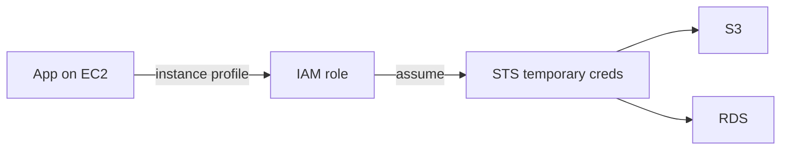

# IAM Policies, Roles and Cross-Account Access

IAM is the backbone of every security question on the exam. If a scenario says "grant access", the answer almost always involves **IAM roles** - never sharing credentials, never embedding keys.

## Policy structure

Every policy is a JSON document:

```json
{
  "Version": "2012-10-17",
  "Statement": [
    {
      "Effect": "Allow",
      "Action": "s3:GetObject",
      "Resource": "arn:aws:s3:::my-bucket/*",
      "Condition": {
        "StringEquals": {"aws:RequestedRegion": "eu-central-1"}
      }
    }
  ]
}
```

The four levers you can pull: **Effect** (Allow/Deny), **Action** (what API call), **Resource** (which ARN), **Condition** (when/where/from which IP).

## Policy types

| Type | Attached to | Notes |
|---|---|---|
| Identity-based | Users, groups, roles | AWS managed, customer managed, or inline |
| Resource-based | S3 buckets, SQS, KMS keys, Secrets Manager | Can grant access to **other accounts** |
| Permission boundaries | A role/user | Caps the maximum permissions |
| SCP (Organizations) | Accounts/OUs | Caps everything in the account - **does not grant** |
| Session policies | Temporary credentials | Rarely tested, caps a role session |

## Policy evaluation logic

This is a classic exam trap. The order:

1. **Start with implicit deny** (everything is denied by default)
2. **Evaluate all explicit denies** - an explicit `Deny` **always wins**, no matter what any `Allow` says
3. Check **SCPs** (and resource control policies) - if no allow at the org level, it stops here
4. Evaluate **resource-based policies** and **identity-based policies** - either one can grant access
5. A **permission boundary** must also allow it (when one exists)

> Not: en onemli kural tek cumle: **explicit deny > allow**. Sinavda "X yetkisi var mi" sorusunda, policy'lerden birinde Deny varsa cevap "yok" tur.

Managed vs inline: **managed policies** are reusable and attach to many principals (use these), **inline policies** are embedded 1:1 (delete the principal, policy goes with it).

## Roles vs users

- **Users** have long-lived credentials (access keys, passwords) - humans only, and only if federation is not possible
- **Roles** issue **temporary credentials** via STS (default 1 hour, up to 12h for EC2) - everything else uses roles

Every "grant a service access to another service" question is answered with a role:

- EC2 needs S3 → **instance profile** (a role attached to the instance)
- Lambda needs DynamoDB → **execution role**
- An app on EC2 needs to call AWS APIs → **never** put an access key on the box; use a role



## Cross-account access

Three ways, know when each is the answer:

1. **Cross-account role assumption (the default answer)** - account B's role trusts account A's principal; account A calls `sts:AssumeRole` and gets temporary credentials. No keys are ever shared.
2. **Resource-based policy** - an S3 bucket policy in account B directly allows account A's role ARN. One step simpler, no AssumeRole call.
3. **IAM Identity Center / federation** - when the question involves *humans* from multiple accounts.

Trust policy = **who can assume the role** (on the role itself). Permissions policy = **what the role can do**. Mixing these up is a favorite exam trick.

> Not: "sifre/paylasilan key ver" hicbir zaman dogru cevap degildir. Scenario'da access key geciyorsa o secenek neredeyse kesin yanlis.

## Exam check

**Q1: An application running on EC2 must read objects from an S3 bucket in another AWS account. What is the MOST secure way to grant this access?**

A) Create an IAM user in the other account and store its access keys on the EC2 instance
B) Create an IAM role in the S3 account that trusts the EC2 instance's role, and assume it
C) Make the S3 bucket public
D) Copy the objects to the local instance store

**Answer: B.** Cross-account role assumption with temporary credentials. A leaks long-lived keys to a server, C is a security hole, D doesn't solve ongoing access.

**Q2: An IAM policy allows `s3:*` and a bucket policy explicitly denies `s3:DeleteObject`. Can the user delete an object?**

A) Yes, the identity policy allows all S3 actions
B) No, an explicit deny always overrides any allow
C) Yes, because resource-based policies are evaluated first
D) Only if the user is in the Administrators group

**Answer: B.** Explicit deny wins over every allow in the evaluation logic.

## Ozet

- IAM policy = JSON "kim, ne, hangi kaynak, hangi sartta"
- Explicit deny > allow, deny-by-default
- Role = gecici credential (STS) - servisler ve cross-account hep role kullanir
- User = uzun omurlu anahtar, sadece insana (tercihen federation)
- Trust policy = "rolu kim kullanabilir", permissions policy = "rol ne yapabilir"
- Instance profile = EC2'ye baglanan role
- Cross-account = AssumeRole ya da resource-based policy
