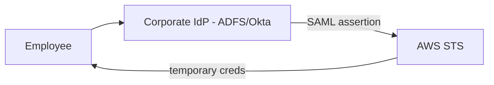
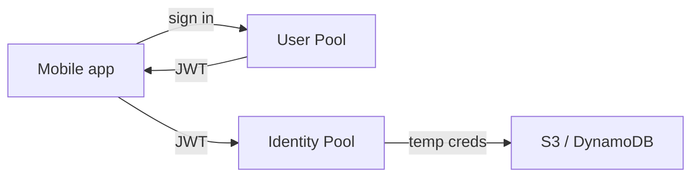

# Identity Federation and Cognito

Creating IAM users inside AWS for every employee is a management nightmare - and the exam knows it. The right answer for "our 500 employees use Active Directory" is always **federation**: let an external identity provider handle the humans, and give them **temporary AWS credentials**.

## Federation with SAML 2.0 (corporate identities)

The scenario keyword is **Active Directory / ADFS / Okta / Azure AD**. Pattern:

- The IdP maps groups → IAM roles (via the `AssumeRoleWithSAML` API)
- **No IAM users are created** in AWS
- Best for **workforce** identities (employees)

**IAM Identity Center** (the artist formerly known as AWS SSO) is the modern managed version of this: connect one IdP, get a single portal with access to many accounts.

## Federation with web identities (customer-facing)

The scenario keywords are **mobile app, social login, "users sign in with Google/Facebook/Amazon"**:

- **Web identity federation** → STS temporary credentials via `AssumeRoleWithWebIdentity`
- **Amazon Cognito** is the service that packages this for you

## Cognito: User Pools vs Identity Pools

This pair appears in almost every "customer login" question. The trick is knowing which one does what:

| | User Pool | Identity Pool |
|---|---|---|
| What it is | A **user directory** (sign-up, sign-in, MFA) | A **credential vending machine** |
| Returns | JWT tokens (authentication) | **AWS temporary credentials** (authorization) |
| Users | Your app's end users | Any authenticated (or guest) user |
| Analogy | "Login system" | "Bridge to AWS services" |

You usually use **both**: the user authenticates against the User Pool, then the Identity Pool exchanges the JWT for AWS credentials so the app can talk to S3/DynamoDB directly.

> Not: soruda "kullanicilar giris yapsin" varsa User Pool, "ve sonra S3'e yazabilsin" gibi AWS erisimi de varsa Identity Pool eklenir. Sadece AWS personeli/employee varsa Cognito degil, SAML federation dogru cevaptir.

## Exam tips

- **"Employees / internal"** → SAML 2.0 federation or IAM Identity Center
- **"Customers / mobile / social login"** → Cognito
- **"Application on EC2 calls AWS"** → IAM role (not federation at all)
- Cross-account access between two AWS accounts → **AssumeRole**, not federation

## Exam check

**Q1: A mobile game lets millions of players sign in with Facebook, and the app needs to write player scores to DynamoDB. Which combination should be used?**

A) IAM users with access keys embedded in the app
B) Cognito User Pool for sign-in + Identity Pool for AWS credentials
C) SAML federation with Active Directory
D) One shared IAM user for all players

**Answer: B.** Social login → User Pool; direct AWS access from the app → Identity Pool. A/D leak shared credentials, C is for enterprise workforce.

**Q2: A company wants its 200 Active Directory users to access multiple AWS accounts with their existing usernames and passwords. What should the architect recommend?**

A) Create one IAM user per employee in each account
B) Federate AD with AWS using SAML 2.0 via IAM Identity Center
C) Store the AD passwords in Secrets Manager
D) Use Cognito User Pools

**Answer: B.** Corporate identities + multiple accounts = SAML federation with IAM Identity Center.

## Ozet

- Federation = dis kimlik saglayici (IdP) insani tanir, AWS gecici credential verir
- SAML 2.0 = kurumsal/ADFS/Okta senaryolari icin
- IAM Identity Center = coklu hesap icin yonetilen SSO portal
- Cognito User Pool = giris/kayit sistemi (JWT doner)
- Cognito Identity Pool = JWT'yi AWS gecici credential'ina cevirir
- Employee = SAML, customer = Cognito
- Hicbir zaman app icine access key koyma
