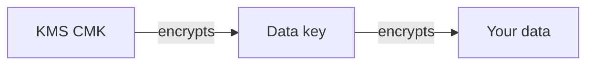

# KMS and Encryption Deep Dive

Encryption questions on the exam come down to one choice: **which encryption option and where do the keys live**. AWS KMS is the default answer for almost all of them.

## KMS key types

| Key | Managed by | Use case |
|---|---|---|
| AWS owned keys (`aws/s3`, `aws/ebs`...) | AWS | Zero setup, no key policy to manage |
| **AWS managed key** (`aws/s3` etc.) | AWS | Automatic for most services, cannot rotate on demand |
| **Customer managed key (CMK)** | You | Full control: key policy, rotation, disable, grants |
| Asymmetric keys | You | Sign/verify or public-key encryption outside KMS |
| Multi-region keys | You | Global tables, cross-region DR with one key |

Automatic rotation: customer managed keys rotate **once a year** (you can trigger early rotation). You cannot export the key material - KMS is the boundary.

## Envelope encryption

KMS never encrypts your big data directly - it encrypts **data keys** that encrypt your data:

- The CMK protects the data key; the data key protects the payload
- This is why encrypting 5 GB with KMS "directly" isn't a thing - and why KMS API calls are cheap but not free
- **Encryption context** = additional key/value pairs in the request; change it and decryption fails (tamper detection)

## S3 encryption options - the classic exam table

| Option | Key location | Exam hint |
|---|---|---|
| **SSE-S3** | AWS manages everything | Default since Jan 2023, "no compliance need" |
| **SSE-KMS** | KMS CMK | Audit trail via CloudTrail, per-key permissions, "compliance" scenarios |
| **SSE-C** | **Customer provides** the key per request | Customer manages keys, S3 never stores them |
| **Client-side** | Customer, before upload | Maximum control, you manage everything |

EBS encryption follows the same pattern (SSE-KMS style, transparent to the OS, cannot "convert" - you must snapshot & copy). RDS encryption is enabled **at creation time** (snapshot-copy-and-restore to encrypt an existing DB).

> Not: "mevcut RDS'i sifrele" sorusu gelirse cevap: snapshot al → sifreli kopyala → yeni instance olustur. Canli instance'i sonradan sifreleme yok.

## Key policies and access

- The **key policy** is the root of trust for a KMS key - it says who can administer and use the key
- **Grants** = programmatic, delegatable permissions (used heavily by other AWS services)
- IAM policies alone cannot grant access to a key unless the key policy allows it
- Cross-account use: the key policy must allow the other account, **and** that account's IAM policies must allow it too (both are required)

## KMS vs CloudHSM

| | KMS | CloudHSM |
|---|---|---|
| Keys | Shared multi-tenant service | **Dedicated** hardware (FIPS 140-2 Level 3) |
| Ops | AWS manages the HSM | You manage the cluster (and the availability) |
| Cost | Pay per API call + key | Pay per hour per HSM |
| Answer when... | 99% of questions | "dedicated HSM / single-tenant / FIPS Level 3 / you own the key material" |

## Exam check

**Q1: A compliance requirement states that all data at rest must be encrypted with keys the customer controls, and every decryption attempt must be logged. Which S3 option?**

- **A)** SSE-S3
- **B)** SSE-KMS with a customer managed key
- **C)** SSE-C
- **D)** Client-side encryption with a key stored in the bucket

**Answer: B.** Customer-controlled key + CloudTrail audit of key usage = SSE-KMS with a CMK. D stores the key next to the data.

**Q2: An on-premises application must encrypt data with a dedicated, single-tenant hardware security module that meets FIPS 140-2 Level 3. What should be used?**

- **A)** AWS KMS with an AWS managed key
- **B)** AWS CloudHSM
- **C)** Secrets Manager
- **D)** S3 SSE-C

**Answer: B.** "Dedicated/single-tenant HSM" = CloudHSM.

## Ozet

- KMS = anahtar yonetimi + sifreleme servisi, varsayilan cevap
- Envelope encryption = CMK data key'i sifreler, data key veriyi
- SSE-S3 = AWS her seyi yonetir, SSE-KMS = audit + kontrol, SSE-C = musteri anahtari verir
- RDS/EBS sifreleme = olusturma aninda; sonradan = snapshot + kopyala
- Key policy KMS'de kok guvendir; cross-account icin hem key policy hem IAM gerekir
- CloudHSM = dedicated hardware, tek kiracili
- Rotasyon = customer managed key'lerde yilda 1 otomatik
