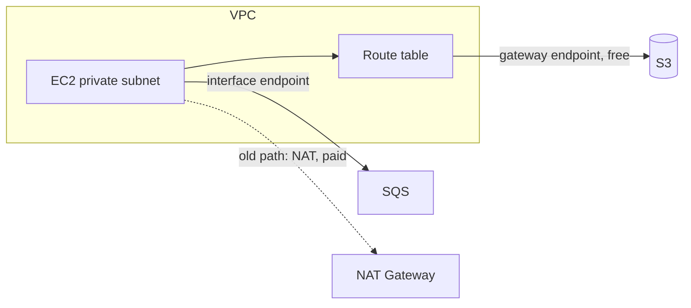

# Network Security: Security Groups, NACLs (Network Access Control List) and VPC (Virtual Private Cloud) Endpoints

Two firewall layers and one private connectivity mechanism - and the exam will absolutely ask you to compare the first two.

## Security Group vs NACL - the mandatory table

| | **Security Group** | **NACL** |
|---|---|---|
| Attaches to | ENI (Elastic Network Interface) / instance | **Subnet** |
| State | **Stateful** (reply traffic auto-allowed) | **Stateless** (allow + deny rules for each direction) |
| Rules | **Allow only** | Allow **and deny** |
| Evaluation | All rules evaluated | Rules in **number order**, lowest first |
| Default | Deny all inbound, allow all outbound | Allow all in/out |
| Use when | Instance-level filtering | Block a specific IP at subnet level |

Key consequences:

- You **cannot block a single IP with a security group** - it has no deny rules. Need to block an abuser IP? **NACL**.
- With a NACL allowing port 80 inbound, you must **also allow the ephemeral return ports** (1024-65535) outbound, or the response dies. This "ephemeral ports" trap is an exam classic.
- Security groups can reference **other security groups** as sources; NACLs only take IP ranges.

Hands-on version: [aws-security-groups](../../../aws/ec2/aws-security-groups/), [private-subnets](../../../aws/networking/private-subnets/).

> Not: kural tek cumlede: "tek IP engelle" = NACL, "sunucuya kural" = Security Group. Stateful/stateless tablosu sinavda neredeyse her oturumda cikiyor.

## VPC Endpoints - private access to AWS services

By default, "instance in a private subnet calls S3 (Simple Storage Service)" goes through a NAT Gateway (costs money per GB). A **VPC endpoint** keeps the traffic **inside the AWS network**:

| Type | Services | How it works |
|---|---|---|
| **Gateway endpoint** | **S3, DynamoDB** only | Route table entry - **free** |
| **Interface endpoint (PrivateLink)** | Almost everything else (SQS (Simple Queue Service), KMS (Key Management Service), API GW...) | ENI with a private IP - **hourly + per-GB cost** |

Why the exam cares:

- **Security**: traffic never leaves AWS; combine with the `aws:sourceVpce` bucket policy from [s3-security](../s3-security-and-access-points/)
- **Cost**: gateway endpoints are free and remove NAT data processing charges - "reduce data transfer cost for S3 access" → gateway endpoint
- **Reliability**: private connectivity even if the NAT is gone

**PrivateLink** is the underlying technology of interface endpoints, and it can also expose **your own service** as an endpoint service to other VPCs/accounts - "share a service privately across accounts without peering" → PrivateLink.

## Exam check

**Q1: A security team must block traffic from a specific IP address to a subnet. Which mechanism?**

- **A)** Security group with a deny rule
- **B)** Network ACL with a deny rule
- **C)** VPC endpoint policy
- **D)** An IAM (Identity and Access Management) policy with an explicit deny

{}
**Answer: B.** Security groups have no deny rules; NACLs do.
{}

**Q2: An EC2 (Elastic Compute Cloud) instance in a private subnet frequently downloads objects from S3. The team wants to eliminate NAT Gateway data processing charges and keep traffic off the public internet. What should be used?**

- **A)** A gateway VPC endpoint for S3
- **B)** An interface VPC endpoint for S3
- **C)** A public IP on the instance
- **D)** CloudFront

{}
**Answer: A.** S3 + cost reduction + private = **gateway** endpoint (free). Interface endpoints work but cost hourly.
{}

## Ozet

- Security Group = instance seviyesinde, stateful, sadece allow
- NACL = subnet seviyesinde, stateless, allow + deny, numarali kural sirasi
- Tek IP engellemek = NACL
- NACL'de donus portlarini (ephemeral 1024-65535) acmayi unutma
- Gateway endpoint = S3 + DynamoDB, ucretsiz, route table
- Interface endpoint (PrivateLink) = diger servisler, saatlik ucretli
- VPC endpoint = internete cikmadan AWS servisine ozel erisim
- aws:sourceVpce = "sadece bu endpoint'ten gelenler" sarti
