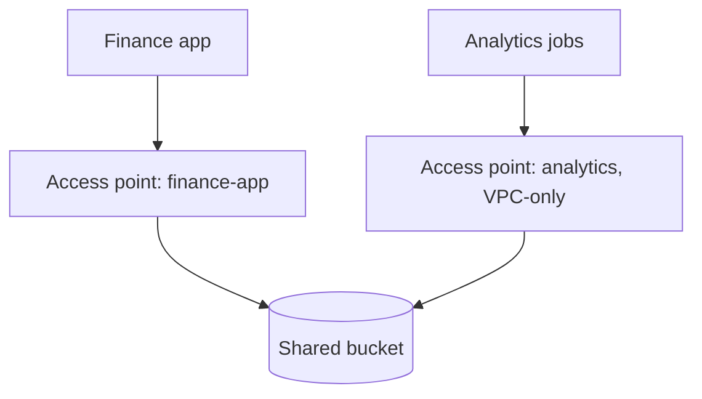

# S3 (Simple Storage Service) Security and Access Points

S3 security questions usually start with "an object was accidentally made public" or "only this VPC (Virtual Private Cloud) may access the bucket". The answer set is small: **Block Public Access**, bucket policies, IAM (Identity and Access Management), and **Access Points**.

## The access control toolkit

| Mechanism | What it does | Exam note |
|---|---|---|
| **Block Public Access** | Master switch; overrides everything | Turn on account-wide, "prevent any public access" |
| **Bucket policy** | Resource-based JSON on the bucket | **Cross-account access**, VPC-only access |
| **IAM policies** | Identity-based permissions | Same-account access for users/roles |
| **ACLs** | Legacy per-object permissions | "ACL disabled / Object Ownership: Bucket owner enforced" is the modern answer |
| **Access Points** | Per-workload entry point with its own policy | Huge buckets, many teams/VPCs |
| **Pre-signed URLs** | Time-limited URL signed with credentials | "Share a private object for 1 hour" |

Handy labs: [aws-s3-bucket](../../../aws/s3/aws-s3-bucket/), [presigned-urls](../../../aws/cdn/presigned-urls/).

## The classic "public website" question

Two patterns appear over and over:

1. **Static website hosting** - bucket policy allows `s3:GetObject` for `*`, Block Public Access off, website endpoint
2. **Private content via CloudFront** - bucket stays private; CloudFront accesses it with **OAC (Origin Access Control)** so users can never hit S3 directly

> Not: sinavda 2023'ten beri "en guvenli" statik site cevabi CloudFront + OAC. Bucket'i public yapmak hala calisir ama "MOST secure" sorularinda kaybeder.

## Restricting access to a VPC

A bucket policy can say "only requests coming through my VPC endpoint":

```json
{
  "Effect": "Deny",
  "Principal": "*",
  "Action": "s3:*",
  "Resource": [
    "arn:aws:s3:::my-bucket",
    "arn:aws:s3:::my-bucket/*"
  ],
  "Condition": {
    "StringNotEquals": {
      "aws:sourceVpce": "vpce-0123456789abcdef0"
    }
  }
}
```

Note the combination: **Deny + StringNotEquals** = "deny everyone not coming from my endpoint". This `aws:sourceVpce` pattern is an exam favorite.

## Access Points

Instead of one giant bucket policy, give each use case an endpoint:



- Each access point has its **own DNS name and policy**
- Can be locked to a **VPC** (`network origin: VPC`) - behaves like a private endpoint
- **Object Ownership: Bucket owner enforced** disables ACLs entirely (the modern default)

## Exam check

**Q1: A security audit found that an S3 bucket allows public ACLs. The requirement is that no object in any bucket of the account can ever be made public. What is the fastest fix?**

- **A)** Delete the bucket policy
- **B)** Enable S3 Block Public Access at the **account** level
- **C)** Enable versioning on the bucket
- **D)** Move objects to Glacier

{}
**Answer: B.** Account-level Block Public Access overrides every bucket policy and ACL.
{}

**Q2: Only instances inside a specific VPC should be able to read a bucket. What should the architect configure?**

- **A)** An IAM role with `s3:GetObject`
- **B)** A bucket policy denying requests where `aws:sourceVpce` is not the VPC endpoint
- **C)** A security group attached to the bucket
- **D)** A pre-signed URL on each object

{}
**Answer: B.** The Deny + `aws:sourceVpce` condition pattern. A doesn't restrict network origin, C is nonsense (SGs (Security Group) don't attach to buckets), D is per-object and temporary.
{}

## Ozet

- Block Public Access = her seyi bastiran ana anahtar, hesap seviyesinde ac
- Bucket policy = cross-account ve VPC-only erisim icin
- ACL = eski teknoloji, "Bucket owner enforced" = ACL'ler kapali
- CloudFront + OAC = en guvenli statik site
- Access Point = kendi politikasi olan is-load endpoint'i, VPC'ye kilitlenebilir
- Pre-signed URL = zaman sinirli paylasim
- aws:sourceVpce ile "sadece bu VPC" sarti kurulur
