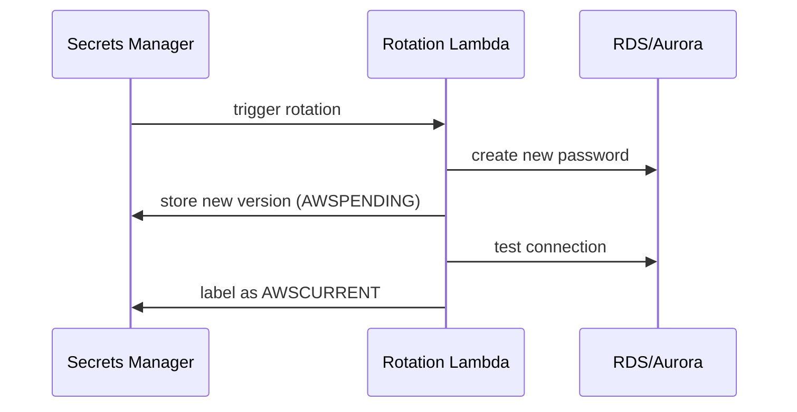

# Secrets Manager vs SSM Parameter Store

The exam loves this comparison - a scenario mentions database passwords or API keys, and you must pick the right vault. Both store secrets encrypted with KMS, but the differences decide the answer.

## Side by side

| | **AWS Secrets Manager** | **SSM Parameter Store** |
|---|---|---|
| Purpose | Secrets (DB creds, API keys) | Config + secrets |
| **Rotation** | **Built-in** (Lambda-backed, automatic) | DIY (custom automation) |
| Cross-account | Native (resource policy) | Via IAM, more work |
| Pricing | **~$0.40/secret/month** + API calls | Standard tier: **free**; Advanced: $0.05/param |
| Size limit | 64 KB | Standard 4 KB / Advanced 8 KB |
| Versioning | Automatic versions + staging labels (`AWSCURRENT`) | Labeled versions |
| Integration | RDS, Redshift, DocumentDB native | Everything via SSM API |

## Decision rule

- "Passwords must be **rotated automatically**" → **Secrets Manager**, no question
- "Cross-account secret sharing" → **Secrets Manager**
- "App config, feature flags, non-secret parameters, budget-conscious" → **Parameter Store**
- "Database credentials for RDS/Redshift/DocumentDB" → **Secrets Manager** (it integrates and rotates them out of the box)

## How Secrets Manager rotation works

The app keeps asking Secrets Manager for the secret by name - it always gets the current version, so the app never knows the password changed.

## Parameter Store details worth knowing

Two tiers:

- **Standard** - free, 4 KB, 10,000 params per account (soft limit), no advanced policies
- **Advanced** - paid, 8 KB, more params, parameter policies (TTL to force expiry!)

Parameters are `String`, `StringList`, or `SecureString` (encrypted with KMS). EC2 instances fetch them via the SSM agent + an instance role - see my hands-on notes: [aws-ssm-parameter-store](../../../aws/iam/aws-ssm-parameter-store/).

> Not: "gizli bilgi + otomatik rotasyon + kurulus icinde guvenli paylasim" = Secrets Manager. "Sadece config saklayacagim, ucuz olsun" = Parameter Store. Sinavda rotasyon kelimesi geciyorsa cevap neredeyse kesin Secrets Manager.

## Exam check

**Q1: A company needs to store database credentials and automatically rotate them every 30 days. Applications run on both EC2 and Lambda across two AWS accounts. Which service?**

A) SSM Parameter Store (Standard tier)
B) AWS Secrets Manager
C) AWS Systems Manager OpsCenter
D) An encrypted EBS volume

**Answer: B.** Automatic rotation + cross-account + managed integrations = Secrets Manager.

**Q2: An application needs 500 non-sensitive configuration values, and the team wants minimal cost. Which option is MOST cost-effective?**

A) Secrets Manager
B) SSM Parameter Store Standard tier
C) KMS encrypted S3 bucket
D) DynamoDB

**Answer: B.** Standard tier parameters are free and designed for exactly this.

## Ozet

- Secrets Manager = sifre kasasi + **otomatik rotasyon**, pahalı ama yonetilmis
- Parameter Store = config + sifre deposu, standard tier **ucretsiz**
- Rotasyon kelimesi geciyorsa → Secrets Manager
- RDS/Redshift/DocumentDB credential'lari → Secrets Manager native rotate eder
- SecureString = KMS ile sifrelenmis parametre
- App'ler ismiyle sorar, hep guncel versiyonu alir
