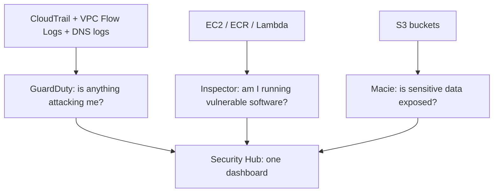

# Security Services: WAF (Web Application Firewall), Shield, GuardDuty, Inspector, Macie and friends

AWS has a swarm of security services with confusingly similar names. The exam doesn't ask how they work internally - it gives you a one-line problem and expects you to name the right one. Learn the **one keyword per service**.

## The keyword map

| Service | What it does | Scenario keyword |
|---|---|---|
| **WAF** | Blocks bad **HTTP requests** (SQLi, XSS, rate limiting) | "web app attacks", "Layer 7", "bad bots" |
| **Shield Standard/Advanced** | **DDoS** protection | "volumetric attack", "availability during DDoS" |
| **GuardDuty** | **Threat detection** on accounts/workloads | "compromised credentials", "malicious IP", "crypto mining" |
| **Inspector** | **Vulnerability scanning** (EC2 (Elastic Compute Cloud), ECR (Elastic Container Registry), Lambda) | "CVEs", "software vulnerabilities", "patch status" |
| **Macie** | Finds **sensitive data (PII)** in S3 (Simple Storage Service) | "credit card numbers", "PII discovery" |
| **Security Hub** | Aggregates findings across accounts | "single dashboard", "security standards" |
| **Detective** | **Investigates** findings, visualizes root cause | "why did this happen", "investigation" |
| **Network Firewall** | Managed firewall for VPC (Virtual Private Cloud) traffic | "IPS/IDS for VPC", "domain filtering" |
| **Firewall Manager** | Centrally manage WAF/SG (Security Group)/Network Firewall across accounts | "apply one policy to all accounts" |

## WAF details worth knowing

- Attaches to **CloudFront, ALB (Application Load Balancer), API Gateway, AppSync** - not NLB (Network Load Balancer), WAF is Layer 7
- Rules: allow / block / count, plus **rate-based rules** ("more than N requests per 5 min from one IP → block")
- Managed rule groups cover OWASP Top 10 out of the box

## Shield: Standard vs Advanced

- **Standard** - free, automatic for CloudFront, Route 53, ELB (Elastic Load Balancing)
- **Advanced** - paid (~$3,000/month + usage), adds **cost protection** against usage spikes during an attack, 24/7 **DDoS Response Team**, and advanced diagnostics

"Financial protection against DDoS-driven scaling bills" → Shield Advanced. That cost-protection angle is the favorite exam hint.

## GuardDuty vs Inspector vs Macie

- GuardDuty **needs no agents** - it analyzes logs with ML
- Inspector agent is now built into the SSM (Systems Manager) agent; scans for CVEs and unintended network exposure
- Macie discovers PII and can trigger findings automatically

> Not: sinavda en yaygin uc eslesme: "web saldirisi" → WAF, "DDoS" → Shield, "hesap ele gecirilmis/supheli aktivite" → GuardDuty. "Zafiyet taramasi" → Inspector, "S3'te PII" → Macie.

## Exam check

**Q1: A company notices its public web application is being targeted by SQL injection attempts. Which service should it deploy?**

- **A)** GuardDuty
- **B)** AWS WAF
- **C)** Amazon Inspector
- **D)** AWS Shield Standard

{}
**Answer: B.** SQL injection is a Layer 7 attack = WAF rules.
{}

**Q2: The security team wants to discover which S3 buckets contain unencrypted credit card numbers. Which service?**

- **A)** Amazon Macie
- **B)** Amazon GuardDuty
- **C)** AWS Config
- **D)** Amazon Inspector

{}
**Answer: A.** Sensitive data discovery in S3 = Macie.
{}

**Q3: A company wants protection against DDoS attacks including reimbursement for scaling costs caused by the attack. Which offering?**

- **A)** Shield Standard
- **B)** Shield Advanced
- **C)** WAF rate-based rules
- **D)** Network Firewall

{}
**Answer: B.** Cost protection + DDoS Response Team = Shield Advanced.
{}

## Ozet

- WAF = web uygulamasina yonelik HTTP saldirilari (SQLi, XSS, bot, rate limit)
- Shield Standard = ucretsiz DDoS, Shield Advanced = para + maliyet korumasi + destek
- GuardDuty = tehdit tespiti (log analizi, agent gerekmez)
- Inspector = acik/zafiyet taramasi (EC2, ECR, Lambda)
- Macie = S3'te PII/hassas veri bulma
- Security Hub = hepsini tek panelde toplama
- Firewall Manager = coklu hesapta guvenlik politikasi yonetimi
